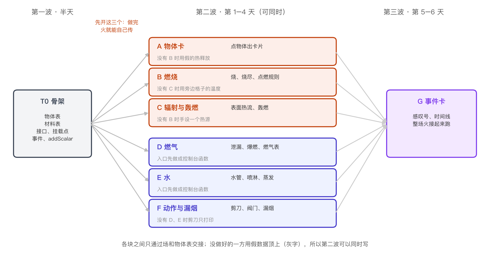

# Duplex 火灾：开工顺序

2026-11-09 写的。配合 `架构.md` 读：架构说「做什么、为什么」，这份说「谁做哪块、按什么顺序、做完怎么检查」。

**用法：** 每开一个 fork，把对应那一节（任务 T0、A、B…）当成它的任务说明。一个 fork 只做一节。

## 为什么要这份

几个 fork 同时写代码，最容易出两种事：

- **两个 fork 改同一个文件**，互相覆盖。
- **一个 fork 等另一个 fork 的东西**，或者各自猜对方的接口，最后接不上。

所以这份文档先定三件事：

1. **每个文件归谁**：一个文件只有一个 fork 能改。
2. **模块之间的接口**：先写在纸上（下面「接口」一节），大家照着写。没写完的部分用假数据顶上，也能先测。
3. **进度写在哪**：每个 fork 在 `进度/` 里有自己的一个文件，写做完了什么、怎么验证的、哪些是假设。你打开这个文件夹，就能看到每个 fork 在干什么，不用进它们的对话里看。

## 波次



| 波次 | 任务 | 能不能并行 | 粗估 |
|---|---|---|---|
| 第一波 | **T0 骨架**：物体表、材料表、接口、模块挂载点 | 只有一个 fork，其他都等它 | 半天 |
| 第二波 | **A 物体卡** · **B 燃烧** · **C 辐射与轰燃** · **D 燃气** · **E 水** · **F 动作与漏烟** | 六个可以同时开；也可以先开 A、B、C | 第 1–4 天 |
| 第三波 | **G 事件卡与时间线**；把各块接起来跑整场火 | 等第二波大部分完成 | 第 5–6 天 |
| 留空 | 出问题的部分、展示准备 | — | 第 7 天 |

**为什么 T0 必须先做、而且只能一个 fork 做：** 物体表、材料表和挂载点是每块都要用的。如果六个 fork 各自建一份物体表，最后会有六份。T0 很小，半天就够了。

**先开哪几个：** 你说过燃烧先做，而且燃烧最直观，所以第二波最要紧的是 A、B、C：做完 A、B、C，火就能从一件家具传到另一件。D、E、F 可以晚一天开，也可以同时开，看你一次愿意盯几个对话。

## 大家都要遵守的

- **只改自己名下的文件。** 想改别人的文件，先在自己的进度文件里写「需要 X 改 Y」，由你来转达。
- **提交只提交自己的文件**（`git add` 具体路径，不用 `git add .`），commit 用英文，结尾加 `Co-Authored-By` 那一行。仓库是公开的：Duplex 的 IFC 和转好的数据不进 git。
- **开工前用两三句话复述自己的任务，等 Billy 点头再写。**
- **模块之间不直接调用，只通过场和物体表。** 例外只有 T0 定的那几个函数（下面写着）。
- **每个数要么带来源，要么标「假设」。** 来源写进 `materials.json` 或卡片内容，不只写在代码注释里。
- **一个模块出错不能拖垮整页。** T0 的挂载点会把每个模块的 `step` 包在 try/catch 里，出错就停掉这个模块并在控制台报错，别的照常跑。
- **大家共用一份工作区**（`室内建筑/` 不开 worktree），因为转好的 BIM 数据被 gitignore 了，worktree 里没有。
- **做完一个阶段就更新 `进度/<任务>.md`**：做了什么、你在页面上能看到什么、和哪个实测数据对过、差多少、哪些是假设、还差什么。

## 现在的代码（2026-11-09）

`duplex-fire/src/` 里已有：

| 文件 | 做什么 |
|---|---|
| mac3d.js | 求解器：交错网格，热、烟灰、燃料守恒（替换了 fluid3d.js + windy.js） |
| house.js | 读 BIM、建网格、HouseFire（t² 设计火加在地面一块格子上） |
| walls.js | 墙吸热 |
| doors.js | 门的开关和画法 |
| pipes.js | 把管子画粗 |
| dressing.js | 材质、阳光、阴影、透明度 |
| smoke-pass.js | 烟和热成像的渲染 |
| main.js | 页面：楼层、拖动起火点、滑块、开关 |

> `架构.md` 里「代码怎么分」那张表还写着 fluid3d.js、windy.js，以这张为准。

T0 之后新加的：

| 文件 | 做什么 |
|---|---|
| world.js | 模块挂载和每一步的顺序；`world.ignite` |
| objects.js | 物体表 |
| events.js | 事件 |
| materials.json | 材料参数，每个数带来源 |
| tools/objects-check.mjs | 在 node 里建物体表、打印各类数量 |

## 接口（T0 已写好，2026-11-09）

> 这一节是 T0 实际写出来的样子（`duplex-fire/src/world.js`、`objects.js`、`events.js`、`materials.json`），以代码为准。细节和检查结果在 `进度/T0.md`。

### 物体表 `world.objects`

`world.objects.list` 是所有物体（670 个），`byId.get('e153')` 按编号取，`byElement.get(element)` 由 BIM 构件取（点选时用 `mesh.userData.element`）。每个物体一条记录：

```js
{
  id,            // 'e153'：在 meta.json elements 里的序号（meta 里没有 GlobalId）
  element,       // meta.json 里的那个构件
  name, type, layer,   // BIM 原名、IFC 类型、图层
  class,         // '软垫' '木柜' '桌子' '台面' '门' '窗' '燃气管' '水管' '排水管' '设备'
  material,      // materials.json 的键：sofa、bed_queen、bed_king、wardrobe、cabinet_run、coffee_table、countertop、door_wood、window、gas_pipe、water_pipe、drain_pipe、appliance
  label,         // 中文名，卡片用
  combustible,   // 会不会烧
  room,          // 所在房间，如 'A102 Living Room'
  min, max, size,// 包围盒和尺寸（米）
  cells,         // 贴着它的空气格子：它往这里写热、写烟，也从这里读温度
  wallAir,       // true：它埋在墙或楼板里，cells 是墙两边一格半内的空气
  area,          // 除底面外的表面积（m²），辐射用
  fuelMJ,        // 总热量（MJ），按材料算；不燃或未知为 null
  // 下面这些会变，world.reset() 时复原
  state,         // '完好' | '受热' | '热分解' | '燃烧' | '烧尽' | '失效'
  flux,          // 表面受到的热流（kW/m²），C 写，B 读
  dose,          // 累积受热，B 写
  hrr,           // 当前热释放（W），B 写，C 和卡片读
  burnedMJ,      // 已经烧掉的热量（MJ），B 写
  ignitedAt,     // 点燃的时间（模拟秒），没点燃为 null
  wet,           // 落在它上面的水（kg），E 写，B 读
}
```

**模型里没有燃气表和调压器**：燃气层只有 10 段管子和 8 个弯头（A、B 两户各一路）。D 要把入户那一端当作「表」的位置，并标「假设」。

### 材料表 `materials.json`

每种材料一条，每个数是 `{ value, unit, source }`。来源以「假设」或「[估]」开头的是我们自己定或算的，其余写明读自哪里。沙发和 Queen 床有逐点实测曲线（`curve`，来自另一个会话整理的 `家具着火数据.md`，读自 NIST 量热数据库 test040 / test038；T0 没有复核原始 CSV）。点燃参数（`ignitionTemp`、`krc`、`criticalFlux`）也来自那份文档，出处是 NUREG-1805。

**T0 之后谁改哪一条：** 家具（连同点燃参数）归 B；燃气归 D；水归 E；门和窗归以后做门烧穿的人。只改自己那几条，每个数都要有来源。

### 每一步怎么挂

**不用改 main.js 来挂模块。** 每个机制一个文件，默认导出一个函数，拿到 world、返回一个模块。world 启动时按名字去找这些文件，有就加载，没有就跳过：

```js
// src/combustion.js
export default function (world) {
  return {
    source(world, dt) { /* 往场里写热和烟 */ },
    react(world, dt) { /* 读 flux，判断点燃 */ },
    reset(world) { /* 重新开始时 */ },
  };
}
```

找的文件名（在 `world.js` 的 `MODULES`）：`sources` `actions` `combustion` `gas` `water` `radiation` `leaks` `card` `eventsView`。同一阶段里按这个顺序跑。还没建的文件会在控制台报 404，这是正常的。

每一步按架构里「每一步的顺序」分五个阶段，模块有哪个方法就在哪个阶段被调用：

| 阶段 | 方法 | 谁 |
|---|---|---|
| 1 | `act(world, dt)` | 动作和源（F） |
| 2 | `source(world, dt)` | 燃烧写热和烟（B）；燃气泄漏写燃气（D）；喷水写水（E） |
| 3 | （求解器和墙吸热，已有） | — |
| 4 | `transfer(world, dt)` | 辐射（C）、漏烟通道（F） |
| 5 | `react(world, dt)` | 物体读场、换状态：B 的点燃、C 的轰燃、D 的燃气表、E 的水管和喷淋 |
| 6 | `report(world, dt)` | 事件和画面（G） |

**一个模块出错只停掉它自己**：控制台打印 `[world] xxx.react threw; xxx is switched off`，其他照跑。

`world` 里有：`fire`（场：`fire.temp` 高于环境的 K、`fire.dens` 烟灰 g/m³、`fire.fuel`、`fire.scalars`）、`grid`、`objects`、`rooms`、`materials`、`events`、`time`，以及 `view`（页面的 `scene` `camera` `renderer` `controls` `cut` `dressed` `doors` `meta` `extraMeshes` `serviceMeshes` `smoke` `rayAt` `roomAt` `LEVELS`，画东西和点选的模块用）。控制台里是 `duplexFire.world`。

### 模块之间唯一能直接调的函数

- `world.ignite(object)`：让一个物体进入「燃烧」。T0 先放了一个最简单的版本（只改状态、报「点燃」事件），**B 用自己的实现替换它**（在模块函数里写 `world.ignite = ...`）。C 的轰燃和 D 的爆燃调用它。
- `world.events.emit(...)`：报事件，见下。

### 往场里写热和烟

和现在 HouseFire 写起火点的方法一样：

- 热：`fire.fuel[c] += dt * q * (1 - 辐射分数) / (1.2 * 1005 * 体积)`，分到物体的 `cells` 上。
- 烟灰：`fire.dens[c] += dt * q / 燃烧热 * 烟灰产率 * 1000 / 体积`（g/m³）。
- 辐射那部分（`q * 辐射分数`）不进空气，由 C 用来算别的物体受到的热流。

### 新的场

燃气和水要随气流走：`const gas = world.fire.addScalar('gas')` 返回一个和网格一样大的数组，随气流搬运和混合，和烟灰完全一样（总量守恒，墙挡得住），单位由你定。它自己的浮力（燃气比空气轻）、产生和消失，都由登记它的模块负责。D 和 E 不改 mac3d.js。

### 事件

```js
events.emit({ type: '点燃', objectId, time, pos, data: { flux: 23 } })
```

`time` 不写就用当前模拟时间；`pos` 是 `[x, y, z]`（米）。`type` 对应 `cards.json` 里的一张卡。没有 G 时，事件只打印在控制台。G 用 `world.events.on(fn)` 接收，`world.events.log` 是全部记录。

### 卡片面板

A 做面板，G 复用。接口：

```js
showCard({ title, rows: [[标签, 值]], live: [[标签, () => 当前值]], sources: [...], image })
```

`live` 那几行每帧刷新，用来显示「这件沙发此刻多少瓦」。

---

## T0 骨架

**目标：** 把上面的接口变成能用的代码。其他任务都靠它。

**名下文件：** `src/world.js`（新）、`src/objects.js`（新）、`src/materials.json`（新）、`src/events.js`（新）。`main.js` 和 `mac3d.js` 只做最小改动：在 main.js 里建 world、挂空的模块；在 mac3d.js 里加 `addScalar`。

**做完能看到：**
- 控制台输入 `duplexFire.world.objects` 能看到 61 件家具加门、窗、管子、燃气表，每件都有类别和材料。
- 页面照常跑，和现在没区别。

**怎么检查：**
- 各类别的数量和架构里对得上：软垫 8、木柜 37、桌子 10、台面 6。
- 加了 `addScalar` 之后，烟和热的守恒数字和改之前一样（README 里有现在的数）。

**依赖：** 无。先要处理掉别的会话没提交的改动。

## A 物体卡

**目标：** 点任何物体，出一张卡：名称、材料类别、实测数据和来源；物体在烧时，加一行此刻的热释放。

**名下文件：** `src/card.js`（新）、卡片的样式。`main.js` 里只加点选的那几行。

**做完能看到：**
- 点客厅沙发：「软垫沙发 · 点燃约 20 kW/m² · 实测峰值 1.8–2.2 MW，约 6 分钟到峰值 · NIST TN 2303（2025）」。
- 它烧起来以后，多一行「现在 1.4 MW」，每帧在变。

**怎么检查：** 每类物体各点一件，卡上的数和 `materials.json` 一致，来源齐全。

**依赖：** T0。还没有 B 时，用假的 `hrr` 测 live 行。

## B 燃烧

**目标：** 物体被点着以后，按自己材料的曲线烧：t² 增长到峰值，再按总热量衰减，直到烧尽；往场里写热和烟；外观变化（发红，然后焦黑）。点燃规则：`flux` 超过阈值并且累积够了，就进入「燃烧」。

**名下文件：** `src/combustion.js`（新）；`house.js` 里 HouseFire 的起火点部分（改成引火源）。外观变化如果要动 dressing.js，先说。

**起火方式（Billy 2026-11-09 定）：** 保留拖动的起火点，当作**引火源**。现在它是一块会长到 1 MW 的 t² 设计火，要改小到 NIST 实验里燃烧器那么大（几十 kW，具体多大要查 TN 2303 用的燃烧器功率，写进 materials.json 并标来源），再由它把家具点着。这和实验的做法一样，家具之后怎么烧完全由材料决定。不做「点家具直接起火」。引火源改在 house.js 的 HouseFire 里，这一处归 B。

**做完能看到：** 起火点放在沙发旁边，沙发被点着，几分钟内烧到兆瓦级，然后变黑。

**怎么检查：**
- 单独烧一张沙发 A，热释放曲线和 NIST TN 2303 对比：峰值 1.8–2.2 MW，6.3–6.6 分钟到峰值，总热量 811–891 MJ。把对比图放进 `进度/B.md`。
- 烟灰总量等于烧掉的质量乘产率。
- 木书架用小火点：烧不起来，或者火源撤掉后熄灭（NBSIR 83-2787：28 kW，燃烧器停后 60 秒熄灭）。

**依赖：** T0。还没有 C 时，`flux` 可以先用「旁边格子的温度」粗算，等 C 做好再换掉。

## C 辐射与轰燃

**目标：** 算每个物体表面受到的热流：燃烧的物体当点源，天花板下的热烟层按 σT⁴。再加轰燃规则：房间热烟超过约 600°C，或地面热流超过约 20 kW/m²，房间里所有可燃物一起点燃。

**名下文件：** `src/radiation.js`（新）。轰燃也写在这里，点燃时通过 T0 定的 `ignite(object)` 让物体进入燃烧。

**做完能看到：**
- 一张沙发在烧，旁边柜子的 `flux` 随距离变化。热成像里可以加一个开关，按热流给物体上色。
- 客厅烧到轰燃时出现事件，整个房间的家具一起烧起来。

**怎么检查：**
- Babrauskas 1981：轰燃前，2 MW 左右的火能点燃 0.44–0.88 m 内的物体。
- 轰燃判据和 NIST 的一致（600°C / 20 kW/m²）。

**依赖：** T0。还没有 B 时，手动设一个物体的 `hrr = 2e6` 当热源来测。

## D 燃气

**目标：** 燃气作为一个随气流走的量（比空气轻）。剪管或泄漏就往场里放燃气；浓度在 5–15% 之间、又碰到火时爆燃；燃气表附近温度过阈值就失效，持续供火；关阀停气。

**名下文件：** `src/gas.js`（新）。剪管、关阀的入口先做成控制台函数（`duplexFire.gas.cut(id)`），鼠标工具交给 F。

**做完能看到：**
- 起火前剪管：燃气积在天花板下，热成像里有一个开关能看到燃气浓度；碰到火，一下烧掉。
- 起火后剪管：破口处多出一个持续的火源，关阀才停。

**怎么检查：**
- 燃气守恒：放出去的量等于场里的加上烧掉的。
- 爆燃只发生在 5–15% 之间。
- 燃气表失效温度在架构里还是「假设」，查到依据再换。

**依赖：** T0 的 `addScalar`。不依赖 B、C。

## E 水

**目标：** 水管受热失效后，在破口处喷水，流量由水网压力决定；可以加装喷淋头，到触发温度就喷；水在热的格子里蒸发吸热（约 2.6 MJ/kg），落在燃烧的物体上会降低它的热释放。

**名下文件：** `src/water.js`（新）。入口同样先做成控制台函数。

**做完能看到：** 同一场火跑两遍，一遍加喷淋、一遍不加，火的走法不一样。

**怎么检查：**
- 蒸发吸热的总量和蒸发掉的水对得上。
- 喷淋触发温度、水管失效温度、水对热释放的影响，在架构里都还是「待查」或「假设」，要在进度里写清楚现在用的是什么数。

**依赖：** T0 的 `addScalar`。降低热释放需要 B：水只往物体上写 `wet`（落上去的水量），B 自己读它来降热释放。

## F 动作与漏烟

**目标：**
- **鼠标工具：** 剪刀（剪燃气管、剪水管）、阀门和电闸、开关设备（如排风机）。点了以后调用 D、E 提供的函数。
- **源：** 电网、燃气网、水网都按无限供应；每个阀门或电闸是一个开关。
- **漏烟：** 每户一个压力（按热膨胀估算），门缝、插座、穿墙孔按面积在两边之间搬烟和热。

**名下文件：** `src/actions.js`、`src/sources.js`、`src/leaks.js`（都是新的）。工具栏的界面。

**做完能看到：**
- 选剪刀，指到燃气管时管子亮起来，点一下就剪开。
- 一户起火，门关着，烟从插座、门缝漏到隔壁户。

**怎么检查：** 漏烟和荷兰消防学院 2020 的实验对比：屋里压力能超过 300 Pa，烟会穿过插座。

**依赖：** T0。剪刀需要 D、E 的函数；还没有时，剪刀先只打印「剪了哪根」。

## G 事件卡与时间线

**目标：** 事件发生的位置出现红色感叹号，同时记到时间线上；点开是卡片：发生了什么、为什么、依据、哪些是假设。先只有文字，图片以后加。

**名下文件：** `src/eventsView.js`（新）、`src/cards.json`（新）。卡片面板用 A 做的。

**做完能看到：** 跑一整场火，时间线上依次出现：点燃 → 旁边的柜子被烤着 → 轰燃 → 燃气表失效……每个都能点开。

**怎么检查：** 每种事件都有一张卡，每张卡都有来源。

**依赖：** T0、A。事件内容要等 B、C、D、E 做出来之后才知道有哪些。

---

## 要 Billy 定的

1. ~~起火方式~~：已定，拖动的起火点改小当引火源（见 B）。
2. **一次开几个 fork：** 六个一起开，还是先开 A、B、C？
3. **T0 开工前：** 现在 `main.js` 等文件里那些没提交的改动怎么处理？
