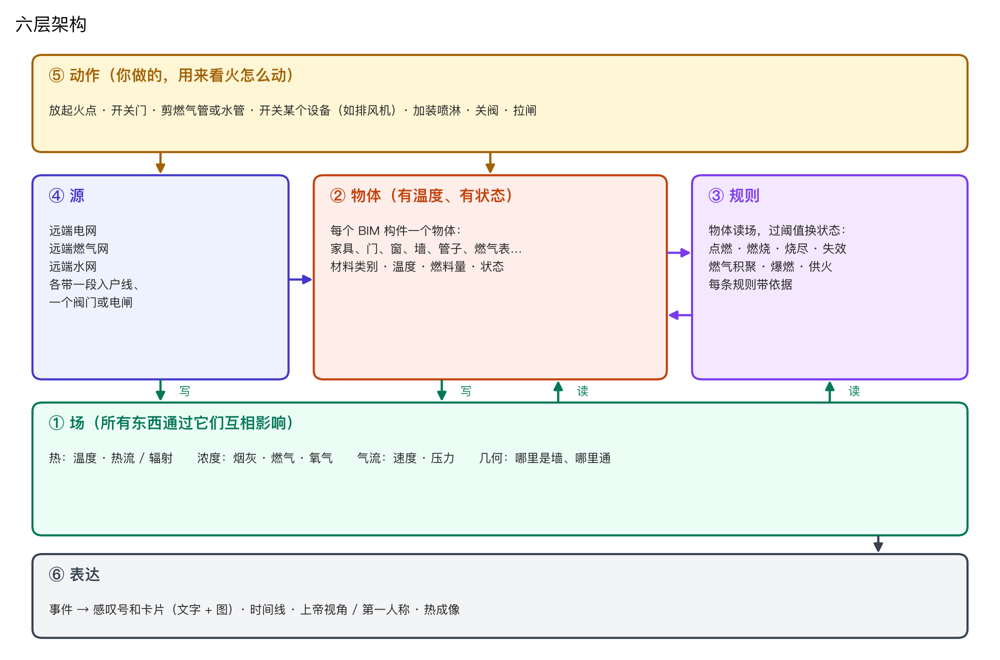
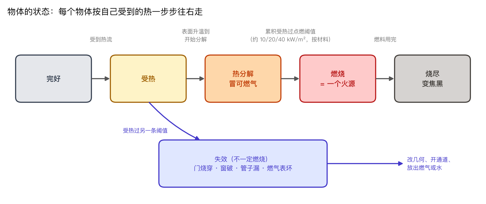
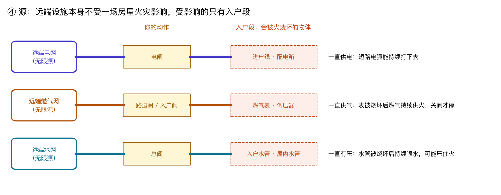
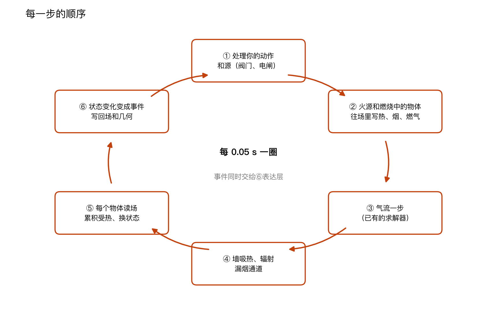

# Duplex 火灾：架构

2026-11-09 定的。比赛还剩一周多。图在 `架构图/` 里，排版好的版本是 `架构.pdf`。

## 主线

**尝试做一些有依据、可视化、能看到、带一点点涌现的东西。**

和之前几份文档的区别（以这份为准）：

- 主线**不是**「每个房间还剩多少逃生时间」。烟感和「撑不住」可以留作一种读数，但不是核心。

- **燃烧先做**：家具会被烤着、会烧、会烧尽，火会从一件传到另一件。「家具不会烧、燃气却会爆炸」不成立。

- **交互是你做的动作**，用来看火怎么动：剪管、开一个泄漏、开关设备、关门、关阀、拉闸。

- **不做自动反应**：火来了自动断电、排风机遇跳闸就停、锅炉断电关阀、灯灭。它们看不出对火的影响，我们也不是智能家居。

- 「家具烧了门打不开」舍掉，没有依据。
- 卡片以后要有文字和图片，先定架构。

## 六层

| 层 | 是什么 | 现在有没有 |
|---|---|---|
| ① 场 | 所有东西互相影响的唯一途径：热、浓度、气流、几何 | 气流、烟灰、热、墙吸热已有；燃气、氧气、辐射没有 |
| ② 物体 | 每个 BIM 构件一个物体，有材料、温度、燃料量、状态 | 没有。门可以开关，但还不是带温度的物体 |
| ③ 规则 | 物体读场、过阈值换状态，每条带依据 | 没有 |
| ④ 源 | 远端电网、燃气网、水网，各带一段入户线和一个阀门或电闸 | 没有 |
| ⑤ 动作 | 你做的事 | 放起火点、开关门已有 |
| ⑥ 表达 | 事件、感叹号和卡片、时间线、两种视角、热成像 | 视角、热成像、色条已有 |

**规矩：机制之间不直接调用，只通过场。** 一个物体被点着，不是去通知旁边的沙发，而是往热场里写热；沙发自己从热场里读到受热，自己决定点不点着。这样加一种新物体不用改别的，联动也不会变成各管各的。

## ① 场

| 场 | 内容 | 状态 |
|---|---|---|
| 热 | 空气温度（K）；每个表面受到的热流（kW/m²），由辐射算出 | 温度有；热流没有 |
| 浓度 | 烟灰（g/m³）；燃气（体积分数，比空气轻）；氧气（体积分数）；喷出的水（kg/m³，会蒸发） | 烟灰有；燃气、氧气、水没有 |
| 气流 | 速度；每户一个压力（热膨胀估算，用来推动漏烟通道） | 速度有；压力没有 |
| 几何 | 哪个格子是墙、哪里通；门缝、插座、穿墙孔这类「小通道」 | 墙和门有；小通道没有 |

辐射是燃烧能传开的关键：没有它，热只能靠热气流过去，火从沙发跳到 1 米外的床就没有依据。做法是把燃烧的物体当点源，把天花板下的热烟层按 σT⁴ 近似，不做完整的辐射传输。

## ② 物体

每个物体的属性：

| 属性 | 来源 |
|---|---|
| 位置、形状、所在房间 | duplex-overlay 转好的 BIM 数据 |
| 材料类别 | 按构件名字归类，见下表 |
| 温度 / 累积受热 | 规则在运行中更新 |
| 燃料量 | 按材料类别和尺寸估算（**待查**） |
| 状态 | 见下图 |

Duplex 里的家具（共 61 件）按燃烧行为可以分成：

| 类别 | 构件 | 数量 | 特点 |
|---|---|---|---|
| 软垫 | 沙发、床 | 4 + 4 | 泡沫，烧得最快，热释放最大 |
| 木柜 | 地柜、高柜、吊柜、洗手台柜 | 16 + 8 + 8 + 5 | 板材，点着慢，烧得久 |
| 桌子 | 茶几 | 10 | 木头，中等 |
| 台面 | 台面 | 6 | 材料未知，先当难燃 |

另外，门（木门可以烧穿）、窗（会受热破裂）、燃气表、调压器、给水管、暖气管、排水管也是物体，主要会「失效」。加装的喷淋头也是物体，它的「失效」就是动作喷水。

### 家具燃烧参数（已查）

数据来自两份 NIST 的家具量热实验：NIST TN 2303（2025 年，现代沙发、床垫、椅子等 48 次实验，在开放空间的量热罩下烧）和 NBSIR 83-2787（1984 年，衣柜和书架）。下表的数字都是原文的实测值，「到峰值」从点火开始计时。

| 类别 | Duplex 构件 | 参考实测 | 峰值热释放 | 到峰值 | 总热量 |
|---|---|---|---|---|---|
| 软垫·沙发 | 沙发 ×4 | 沙发 A（57 kg，3 次） | 1.8–2.2 MW | 6.3–6.6 min | 811–891 MJ |
| | | 沙发 C（51 kg） | 4.0 MW | 6.1 min | 633 MJ |
| | | 带贵妃位的沙发 B（97 kg，3 次） | 3.0–5.2 MW | 5.9–10.7 min | 约 1410–1430 MJ |
| 软垫·床 | 床 ×4 | 床垫 A（弹簧，泡沫少） | 164–189 kW | 4.4–4.7 min | 83–99 MJ |
| | | 床垫 B，没铺 / 铺了床品 | 0.9 / 3.4 MW | 约 12 min | 353 / 442 MJ |
| | | 床垫 C，没铺 / 铺了床品 / 去掉阻燃层 | 2.8 / 4.6 / 7.1 MW | 17 / 13 / 8 min | 647 / 737 / 696 MJ |
| 木柜 | 地柜、高柜、吊柜、洗手台柜 ×37 | 12.7 mm 胶合板衣柜，装衣物（3 次） | 平均 3.3 MW | — | — |
| | | 3.2 mm 薄胶合板衣柜 | 超过 6 MW | 约 2 min | — |
| | | 19.1 mm 刨花板衣柜，120 kg，装衣物 | 两个峰：约 1.9 MW（约 5 min）、约 1.2 MW（约 17 min） | — | 1349 MJ |
| 小木件 | 茶几 ×10 | **没有直接数据** | — | — | — |
| 台面 | 台面 ×6 | 材料未知 | 先当不燃 | — | — |

刨花板衣柜的两个峰是我从原文的曲线图上读的，其余都是原文写出的数字。

**最重要的一条发现：软垫和木头是两种完全不同的燃烧。**

- **软垫家具自己就能烧到兆瓦级。** 一张沙发或一张铺了床品的床，就足以让一个房间轰燃。

- **木家具用小火点不着，点着了也会自己灭。** NIST 的刨花板边桌、NBS 的胶合板书架，火源一拿开就不能持续燃烧：书架在 50 kW 燃烧器下只烧到 28 kW，燃烧器停了 60 秒就灭了。木衣柜能烧到几兆瓦，是因为里面装了衣物。

- **所以木柜、茶几要靠旁边的大火或轰燃的辐射才会真正烧起来。** 这让「辐射 → 点燃」这条机制成了火能不能传开的关键：沙发烧起来，烤着旁边的柜子，柜子再变成新的火源。这就是我们要的那一点涌现，而且每一步都有依据。

**同一份 NIST 报告还给了几个能直接替换引擎假设的数：**

| 量 | 引擎现在 | NIST TN 2303 实测 |
|---|---|---|
| 辐射分数 | 0.35 | 沙发 0.32–0.50；床垫 0.34–0.50；椅子 0.26–0.57 |
| 烟灰产率 | 0.05 | 沙发 0.014–0.017；床垫 0.025–0.038；全部平均约 0.03 |
| 有效燃烧热 | 25 MJ/kg | 沙发 15.6–18.5；床垫 11–25 MJ/kg |
| CO 产率 | 没有 | 沙发 0.030–0.037；床垫 0.018–0.076 |

**进引擎时要做的假设（都要标出来）：**

- **曲线形状：** 按 t² 增长到峰值，再按总热量衰减。峰值、到峰值时间、总热量用上表的实测值，形状本身是假设。

- **选哪个样本：** 床默认用「床垫 B 铺了床品」，沙发默认用「沙发 A」。都可以在界面里换。

- **木柜：** 按质量从刨花板衣柜缩放。厨房地柜没有衣物，又比衣柜小，所以峰值会低得多；具体缩多少是假设。

- **茶几：** 没有数据，按木头处理，只在强辐射下才点燃。

- **「到峰值」的时间是从燃烧器点火算的**，我们的家具被辐射引燃后，起步可能更快或更慢。

## ③ 规则

| 规则 | 读 | 阈值 | 写 | 依据 |
|---|---|---|---|---|
| 点燃 | 表面热流、累积时间 | 约 10 / 20 / 40 kW/m²，按材料；热流越大越快 | 物体进入「燃烧」 | Babrauskas 1981；SFPE 引燃指南 |
| 燃烧 | 自己的燃料量（以后加氧气） | — | 按材料的热释放曲线往热、烟灰、CO、气流里写；消耗燃料 | NIST TN 2303（2025）；NBSIR 83-2787（1984） |
| 烧尽 | 燃料量 | 用完 | 停止放热，外观变黑 | — |
| 轰燃 | 房间热烟温度、地面热流 | 约 600°C 或 20 kW/m² | 房间里所有可燃物一起点燃 | NIST |
| 燃气积聚与爆燃 | 燃气浓度、附近有没有火 | 5–15% 且碰到火源 | 一次烧掉这部分燃气；冲开门窗 | NTSB 调查报告 |
| 燃气表失效 → 供火 | 表附近温度 | **假设** | 燃气持续喷出，被点着成为火源 | 加州 CPUC、马萨诸塞州 DPU 事故报告（火烧化表组、调压器） |
| 门烧穿 | 门的累积受热 | **待查** | 门洞变通 | 待查 |
| 窗破裂 | 窗附近温度 | **待查** | 窗变通，进氧 | 待查 |
| 塑料排水管失效 | 墙里管段的累积受热 | 1 小时耐火墙约 48–53 分钟 | 那段墙变成通道 | NBS 1973 |
| 漏烟通道 | 两边压差 | — | 按孔的面积搬烟和热 | 荷兰消防学院 2020 |
| 水管失效 → 喷水 | 管段的累积受热 | **待查**（塑料管软化、铜管接头开焊） | 在破口处放出水，流量由水网压力决定 | 多位消防队长在地方新闻里说，烧化的塑料管或烧开的铜管喷水，「像喷淋头一样」压住了火（Yacolt 2017 等六起）。只有新闻，没有系统研究 |
| 水的作用 | 水的浓度、所在格子的温度 | — | 蒸发吸热（约 2.6 MJ/kg）；蒸汽稀释氧气；落在燃烧的物体上，降低它的热释放 | 水雾灭火研究：冷却、稀释氧气、减少燃料蒸发。2.6 MJ/kg 是 335 + 2257 kJ/kg 相加，加法是我算的 |
| 喷淋头动作 | 喷淋头处的温度 | **待查**（触发温度） | 喷水 | NFPA：有喷淋的住宅，每千起火灾的死亡率低 74–88%；火够大时约 91–95% 会动作 |

## ④ 源

查下来，一场房屋火灾几乎影响不到远端设施本身，受影响的只有入户那一段。所以源的作用是**供应**：

- **燃气网：** 一直供气，所以燃气表被烧坏后燃气火烧不完，只有关阀才停。有正式事故报告。

- **电网：** 一直供电，所以短路电弧能持续打下去。有一份调查案例，但方向相反：进户线打电弧，在屋里引发火。邻居受影响只有论坛个案。

- **水网：** 一直有压，所以水管被烧坏后会一直喷水，有新闻记载这样压住了火。水网本身只在野火、大量消防用水时才会受影响（压力下降、被污染），一场房屋火灾到不了这个程度。

## ⑤ 动作

| 动作 | 对火的可见影响 |
|---|---|
| 放起火点 | 火从这里开始 |
| 开关门 | 气流和烟的走向变化；以后加氧气后，开门会让火猛涨 |
| 剪燃气管（起火前） | 燃气积在天花板下，碰到火就爆燃 |
| 剪燃气管（起火后） | 被火点着，变成持续的燃气火 |
| 开关设备（如屋顶排风机） | 排风开着时烟被抽走 |
| 剪水管 | 破口处喷水：看水管能不能压住火 |
| 加装喷淋 | Duplex 没有喷淋。同一场火，加和不加，火怎么走 |
| 关阀 / 拉闸 | 燃气火停；喷水停；用电设备停 |

## ⑥ 表达

- 事件发生的位置出现感叹号，同时记到时间线上。
- 卡片：名称、时间和位置、发生了什么、为什么、依据（谁说了什么、读的是原文还是摘要）、模拟里哪些是假设，以后加图。
- 已有：上帝视角（半透明墙、管线图层）、热成像和温度色条。第一人称和楼梯以后接上。

## 每一步的顺序

1. 处理你的动作和源（阀门、电闸）。
2. 火源和燃烧中的物体往场里写热、烟灰、燃气。
3. 气流走一步（现有的求解器）。
4. 墙吸热、辐射、漏烟通道。
5. 每个物体读场，累积受热，换状态。
6. 状态变化变成事件，写回场和几何，同时交给表达层。

## 代码怎么分

在 `duplex-fire/src/` 里：

| 文件 | 做什么 | 状态 |
|---|---|---|
| fluid3d.js、windy.js、house.js | 场：气流、热、烟灰、网格 | 已有 |
| walls.js | 墙吸热 | 已有 |
| doors.js | 门的开关和画法 | 已有 |
| objects.js | 从 BIM 数据建物体表，材料类别，状态 | 新 |
| materials.json | 每类材料的点燃阈值、热释放曲线、燃料量，每个数带来源或标「假设」 | 新 |
| combustion.js | 点燃、燃烧、烧尽、轰燃 | 新 |
| radiation.js | 表面热流 | 新 |
| gas.js | 燃气浓度、爆燃、供火 | 新 |
| water.js | 水管失效、喷水、喷淋、蒸发吸热 | 新 |
| leaks.js | 每户压力、门缝、插座、穿墙孔 | 新 |
| sources.js、actions.js | 源、阀门、电闸，你的动作 | 新 |
| events.js、cards.json | 事件和卡片内容 | 新 |

## 一周顺序（粗估）

1. **第 1–2 天：** 物体表、材料类别、热释放曲线（先查数据）；燃烧和烧尽，外观变化。
2. **第 2–3 天：** 辐射、点燃、轰燃。到这里，火能自己从一件家具传到另一件。
3. **第 4 天：** 燃气浓度、剪管、爆燃、燃气表供火、关阀。
4. **第 5 天：** 源和动作，包括水网、剪水管、加装喷淋；门缝、插座漏烟。
5. **第 6 天：** 事件和卡片（先文字）。
6. **第 7 天：** 留给出问题的部分。

## 待查

- 木柜按质量缩放的依据；茶几、台面的材料。
- 木门烧穿要多久。
- 窗户受热破裂的温度。
- 燃气表、调压器失效的温度。
- 喷淋头的触发温度。
- 塑料水管软化、铜管接头开焊的温度。
- 水落在燃烧的家具上，热释放降多少。

## 水的来源

- 水管喷水压火（都是地方新闻，消防队长的说法）：[Yacolt 2017](https://columbian.com/news/2017/jul/23/burst-water-pipe-helps-control-yacolt-house-fire) · [Langhorne 2022](https://levittownnow.com/2022/03/17/burst-water-pipe-slows-house-fire/) · [Lyndhurst（铜管）](https://dailyvoice.com/new-jersey/rutherford/police-fire/smoke-alarms-save-lyndhurst-family-in-basement-fire/627828) · [Bristol Borough](https://lowerbuckssource.net/cops-courts-fire-bristol-borough/meled-watler-line-bristol-2-edit-1/amp/) · [Cummington](https://gazettenet.com/?p=224933) · [Agassiz](https://www.agassizharrisonobserver.com/news/saving-grace-1947554)
- 水怎样压火：[Wighus，水雾灭火](https://iwma.net/fileadmin/user_upload/press_articles/Aha_RagnarWighus_Feb2019.pdf) · [水基灭火机理综述](https://encyclopedia.pub/entry/40854)
- 喷淋：[NFPA，U.S. Experience with Sprinklers](https://firesprinklerassoc.org/wp-content/uploads/2014/02/U.S.-Experience-with-Sprinklers-and-Other-Fire-Extinguish-Equipment-1.pdf) · [NFPA 可靠性报告的报道](https://www.csemag.com/nfpa-report-finds-higher-estimated-reliability-of-fire-sprinklers/)
- 水网在野火中被污染：[Santa Rosa](https://newsdeeply.thenewhumanitarian.org/water/articles/2018/4/3/after-deadly-wildfire-a-new-problem-for-santa-rosa-contaminated-water) · [Whelton 等 2021，塑料管受热析出](https://pubs.rsc.org/en/content/articlehtml/2021/ew/d0ew00836b)

## 家具燃烧的来源

- Hamins A. 等，*The Character of Burning Residential and Office Items*，NIST TN 2303，2025 年 3 月。[doi.org/10.6028/NIST.TN.2303](https://doi.org/10.6028/NIST.TN.2303) · [NIST 量热数据库（FCD）](https://www.nist.gov/el/fcd)
- Lawson J.、Walton W.、Twilley W.，*Fire Performance of Furnishings as Measured in the NBS Furniture Calorimeter, Part I*，NBSIR 83-2787，1984。[nvlpubs.nist.gov/…/nbsir83-2787.pdf](https://nvlpubs.nist.gov/nistpubs/Legacy/IR/nbsir83-2787.pdf)
