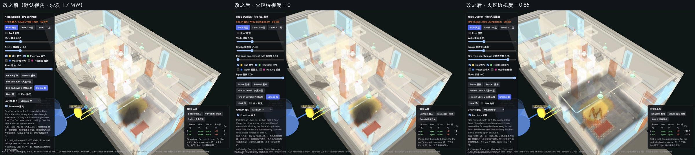
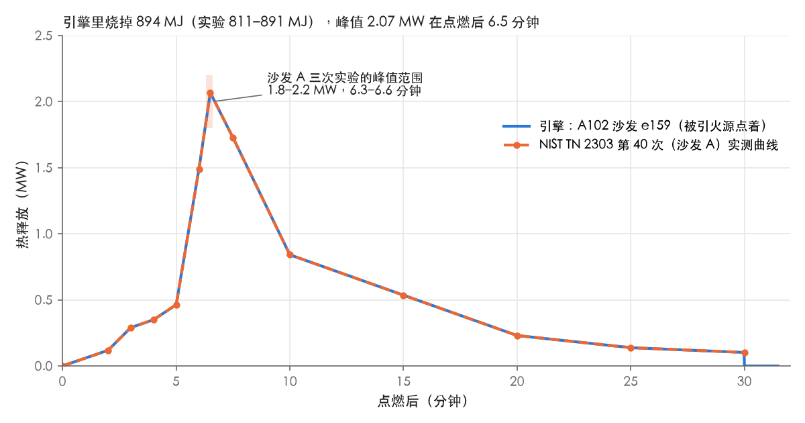
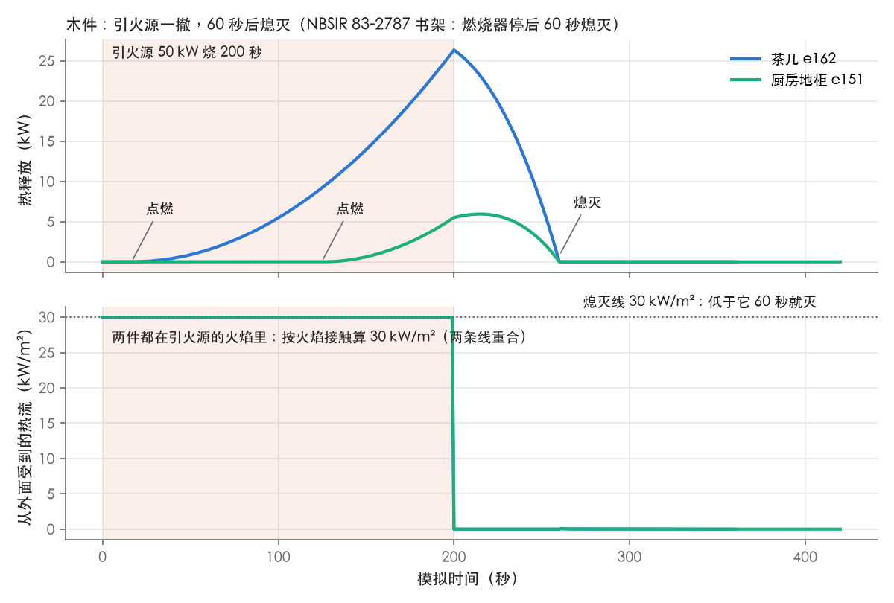

# B 燃烧：第一版做完（2026-11-10）

## 一句话

家具现在会自己烧起来：拖动放的火变成了 **50 kW、烧 200 秒就灭的引火源**（NBS 点家具用的燃气燃烧器）。家具被它的火焰碰到、或被别的火烤到，累积够了就点着，按自己材料的曲线烧（沙发、床用 NIST 实测曲线），往场里写热和烟，烧完变黑。**木头离了外来的热会自己灭**，泡沫不会。

调研在同一个文件夹的 `燃烧蔓延与材料损坏.md`。

## 做了什么

- **`duplex-fire/src/combustion.js`（新）**：点燃、燃烧、熄灭、被水淋、外观，以及给卡片用的数据。world 自动加载它，没改 main.js。用自己的版本替换了 `world.ignite`，C 的轰燃、D 的爆燃调的就是它。
- **`duplex-fire/src/house.js`**：只改了 HouseFire 的起火点部分。
  - 页面里拖的火，现在是引火源：放下就是 50 kW，200 秒后熄灭。
  - 别的任务的检查脚本（`tools/` 里）创建 HouseFire 时传了 `growth`，它们照旧拿到原来的 t² 设计火，结果不变。
- **`duplex-fire/src/materials.json`** 的家具条目：
  - 新增 `igniter`（引火源）。
  - 软垫加 `pyrolysisTemp`；木件加 `pyrolysisTemp`、`extinctionFlux`、`extinctionDelay`、`extinctionUntil`。
  - 茶几：原来的 `peakHRR: null` 换成 `peakHRRPerArea` 和 `timeToPeak`；加了 `totalHeatPerArea`，总热量按大小算（见下面「茶几按大小」）。
  - 每个数都带来源或「假设 / [估]」。
- **`duplex-fire/tools/combustion-check.mjs`、`combustion-plot.py`（新）**：下面「检查了什么」的数和图都由它们产出，原始结果是本文件夹里的 `combustion-*.json`。

## 规则

### 点燃

- **累积受热：** 稳定热流 q 下的着火时间是 t = (π/4)·kρc·(T着 − T0)²/q²（`家具着火数据.md`），所以 q²·t 要攒够。热流高于临界热流时，每步加 q²·dt，攒够 (π/4)·kρc·(T着 − T0)² 就点着。
- **低于临界热流永远不着**，已攒的按 (q临界² − q²)·dt 往回掉，表示表面在散热（**假设**）。
- **为什么用 q² 而不是 (q − q临界)²：** 用 q²，沙发在 20 kW/m² 下 27 秒点着，落在 Babrauskas 1981 实测的 18–43 秒里；用 (q − q临界)² 要 75 秒，出了范围。
- **受到的热流取三者里最大的**（不相加，免得同一份热算两次；**假设**）：
  1. C 写的 `flux`：燃烧物和引火源的辐射、烟层的辐射。
  2. **火焰接触：30 kW/m²**（NIST TN 1446：「火焰接触的热流在 30 kW/m² 或以上」）。物体在别的火的火焰里就算接触。火焰的范围 = 燃烧物（或引火源）的平面范围向四周伸 0.2 m（TN 1446：床的火焰向旁边伸出 20–39 cm，取小的），高度按 Heskestad 公式，**到头顶的天花板为止**（2026-11-11 修，见「检查了什么」第 5 条）。
  3. 碰着它的热气：h·ΔT + σ(T⁴ − T0⁴)，ΔT 取它自己格子里最热的一格。这是热烟层烤高柜顶部的那条路。
- **为什么要「火焰接触」：** 50 kW 燃烧器当点源，旁边的物体最多只收到约 12 kW/m²（C 规定 R 不小于火的半径），放在物体底下时是 0；20 cm 格子里它的火焰只比环境高约 200 K。只靠这两条，引火源什么都点不着。而 NBS 正是用这个燃烧器碰着家具把它点着的。
- **都当作有引火**（**假设**）：TN 1446 里没有火苗引燃的东西只变褐不着火，但「没有引火时多少热流会着」没查到数。

### 燃烧

- **沙发、Queen 床：** 按 NIST 实测逐点曲线（FCD test040 / test038）。King 床按面积把 Queen 的放大 1.31 倍。
- **其他（高柜、地柜/吊柜、茶几）：** t² 长到峰值，再按指数衰减，衰减快慢由「总热量对得上」定。形状是**假设**。
- **茶几按大小（2026-11-10 Billy 定）：** 原来不管大小都是 225 MJ（UL 一张 16.7 kg 茶几 × 木材热值），小茶几要烧 4 个多小时。UL 那张的尺寸没找到，所以**假设**它就是 Duplex 里的大茶几（1.83 × 0.915 m），把 225 MJ 按平面面积摊开：每平方米 135 MJ。峰值也按面积（168 kW/m²），所以两种茶几的燃烧时间一样长：

  | | 总热量 | 峰值 | 烧完 |
  |---|---|---|---|
  | 大茶几 1.83 × 0.915 m（客厅 2 张） | 226 MJ | 281 kW | 约 56 分钟 |
  | 小茶几 0.61 m 见方（客厅 4 张、卧室 4 张） | 50 MJ | 63 kW | 约 56 分钟 |

  objects.js 的 `fuelOf` 不认识「每平方米」，算出来还是 225；combustion.js 启动时把每张茶几的 `fuelMJ` 改成按面积算的数，卡片读到的就是对的。objects.js 归 T0，更干净的做法是让 `fuelOf` 自己认 `totalHeatPerArea`。
- **往场里写：** 用 HouseFire 原来的公式，分到物体自己的 `cells` 上；辐射分数、燃烧热、烟灰产率按材料取。辐射那部分不进空气，留给 C。
- **实测曲线的 0 秒是 128 W 小火苗点枕头的时刻。** 被辐射烤着的家具，开头慢的那段可能更短，没有数据，先照原曲线。

### 熄灭

- **木头：** 燃烧中的木件从外面收到的热流低于 30 kW/m²，持续 60 秒就灭；这 60 秒里放热线性降到 0（**假设**）。
  - 30 kW/m²：Bartlett 2017 是 31（转引），Emberley 2017 是 45（原文），取低的。
  - 60 秒：取自 NBSIR 83-2787 书架实验本身。所以下面「书架」那项检查只说明规则在起作用，不算独立验证。
- **茶几（敞开的）任何时候都会灭；柜子（封闭的箱子）只在烧到峰值以前会灭**，火进到箱子里面以后就自己烧下去（**假设**：NBS 装衣物的衣柜一旦烧起来就烧完了）。
- **泡沫不会灭**：TN 2303 里 128 W 的小火苗就能把沙发点着并烧完。
- **灭了以后：** 状态是新的「熄灭」，积累清零，要重新烤够才会再着，着了从曲线上停下的地方接着烧。
- **水：** 读 E 写的 `wetRate`（mm/s），放热按 exp(−t/τ) 降，τ = 3.0 × wetRate^−1.85 秒（Evans 1993，NISTIR 5254 式 4，保守的那条）。降到不足 2% 就熄灭（**假设**）。E 提醒过：暴露在外的沙发实测 τ 只有 9 秒，这条公式给 410 秒，偏慢很多。

### 状态

完好 → 受热（受到 ≥ 1 kW/m²）→ 热分解（估算表面温度到 250 °C）→ 燃烧 → 烧尽；木件可能 燃烧 → 熄灭 → 再燃烧。「熄灭」是新加的状态。事件有 `点燃`、`熄灭`、`烧尽`。

### 外观

- 燃烧：从暗红到橙黄，按此刻放热占峰值的比例，带一点闪动；烧掉一半以后开始往焦黑里混。
- 受热、热分解：慢慢变褐。
- 烧尽：焦黑。熄灭：按烧掉的比例变黑。
- 做法和 C 的「Flux 热流」上色一样：给家具罩一层颜色，没有新的体积渲染，没动 dressing.js。C 的开关打开时，它那层在上面。

## 给卡片（A）用的数据

每件会烧的家具有 `o.burn`，都是普通数据，不用调用函数：

| 字段 | 是什么 |
|---|---|
| `phase` | cold / heating / pyrolysing / burning / out / burnt |
| `dose`、`doseToIgnite` | 已攒的受热和点燃需要的，(kW/m²)²·s；两者之比就是「还差多少会着」 |
| `surfaceC` | 估算的表面温度（°C）。热流稳定且高于临界值时是准的，其余是**估算** |
| `heatIn` | 此刻从外面受到的热流（三者取最大，kW/m²） |
| `criticalFlux`、`ignitionTemp`、`extinctionFlux` | 画门槛线用 |
| `t` | 在自己曲线上的时间（秒）。灭了再着时会接着走，所以**比 `world.time − ignitedAt` 准** |
| `curve`、`kind` | 这一件的曲线 [[秒, kW]]；kind 是 measured（实测）或 assumed（假设形状） |
| `peakW`、`totalMJ` | 这一件的峰值和总热量 |
| `history`、`samples` | 每秒一个样本：[时间, 受热 kW/m², 表面 °C, 放热 kW] 依次排在一个 Float32Array 里，共 samples 个 |

**需要 A 改的（由你转达）：**
- 卡片上的圆点改用 `o.burn.t` 和 `o.burn.curve`，这样柜子、茶几也有曲线，King 床用放大后的曲线。没有实测的用虚线加「假设」。
- 加一张「受热 / 表面温度 − 时间」的图，画 `history`，标出临界热流线和点燃温度线；木件燃烧时标熄灭线。
- materials.json 里新加的 `peakHRRPerArea`、`pyrolysisTemp`、`extinction*` 字段，卡片会按原名显示，最好给它们中文标签。

## 你在页面上能看到什么

- 把火拖到客厅沙发前面：引火源 50 kW。约 12 秒后沙发点着，几分钟后到 2 MW 左右，前面的茶几也被烤着；之后变黑。
- 只放在一张茶几下面：茶几会着，引火源 200 秒熄灭后，茶几再烧 60 秒就灭。
- 控制台：`duplexFire.world.combustion.status()` 列出所有不是「完好」的家具：状态、kW、受热进度、表面温度、受到的热流。
- **截图还没有**：这次 Browser 面板是隐藏的，截不到画面。外观已在页面里确认：燃烧、焦黑、变褐三种颜色都画上了（按上色层的颜色和透明度核对）。

## 火焰和火区透视（2026-11-11，等你在页面里看过再提交）

**为什么做：** 家具着了只是变红，看不出火；画了火以后，从上往下看又被烟整个盖住。

**火焰（`src/flames.js`，新）：**
- 目标是看起来像火，不求物理精确。只有大小按物理来：Heskestad 火焰高跟着热释放走。
- 画面上有：几条火舌、火星、把房间映红的灯。浇水会冒白汽，熄灭后留下余烬，大火顶到天花板会沿天花板往外卷。
- 对外只有一个接口「这里有一团火，多大」。B 的家具和引火源已经接上，煤气火以后照这个接。
- 调研和取舍写在 `真实火焰与画法.md`。按你的意思，画面只留看得出来的几条，其余放在文档里。
- 实验页：`tools/flame-lab.html`。双击就能打开的版本是 `进度/B/火焰演示.html`。

**火区透视（你的想法）：** 新加一个「火区透视度」滑杆，放在「烟浓淡」下面。挡在着火区域前面的烟、墙、楼板、家具、管线和门会变透明；其他地方的烟照常。
- 着火区域：每件在烧的东西和引火源的火焰盒子，也就是平面向外扩 0.2 m，从底一直到火焰顶或天花板，最多 8 个。由 `combustion.js` 的 `fireZone()` 交出去。
- 烟（`smoke-pass.js`，主引擎同意 B 改）：每个像素沿视线算一次碰没碰到着火区域，碰到就把区域前面那段烟变薄。不加额外的渲染步骤，也不加体积渲染。
- 房子（`main.js`，同上）：用 `fadeForZone()` 处理 main.js 原来就在处理的那批材质（墙、楼板、家具、管线、门）。在着火区域前面的部分按 4×4 的固定图案丢掉一部分像素，和 main.js 现在淡化另一层楼的方法一样。dressing.js、doors.js、gas.js、water.js 都没动。

- **滑杆为 0 时和改之前一样**（左、中两张）。烟的计算里，透视的部分乘的是 1 − 0；房子的材质只有在有着火区域、且滑杆大于 0 时才丢像素；墙没有改成半透明，画的先后顺序也没变。
- **滑杆 0.85**（右）：A102 上方的烟被打开，楼上的楼板和墙在火前面的部分变透明，能看到沙发上的火。

**耗时**（GPU 计时，在默认视角、1920×1200 的画面上量；每种情况量三轮，每轮 15 帧取中位数）：

| 着火区域 | 房子那一遍 | 烟那一遍 |
|---|---|---|
| 0 个 | 17.3 / 16.9 / 17.5 ms | 17.2 / 17.3 / 18.4 ms |
| 1 个 | 16.1 / 17.1 / 17.7 ms | 16.1 / 17.9 / 17.5 ms |
| 8 个 | 16.7 / 16.9 / 17.3 ms | 17.0 / 17.6 / 19.0 ms |

改之前烟那一遍是 15.9–16.6 ms。这几个数之间的差别和测量本身的跳动一样大，看不出透视多花了时间。8 个区域时最多也就 1 ms 左右。**顺便发现：** 这个分辨率下，光画面（房子加烟）每帧就占 GPU 约 35 ms，和模拟步分开算。你 Mac 发烫，画面是一大块原因，不只是模拟。

**还没透视到的（要动别人的文件，列出来给你定）：**
- B 自己的家具染色层和 C 的热流染色层不跟着变透明。它们是叠在家具上的另一层网格，家具变透明了，染色还在。
- 煤气视图和水视图自己的网格（燃气罐、水箱、高亮的管线）用的是 gas.js、water.js 自己的材质，不跟着透视。
- 信息卡、起火点标记、拖动时的影子标记不变。

## 检查了什么

### 1. 点燃时间（`node tools/combustion-check.mjs ignition`）

| 材料 | 临界热流 | 20 kW/m² 下 | 40 kW/m² 下 | Babrauskas 1981 表 3 |
|---|---|---|---|---|
| 沙发、床（布面泡沫） | 16 | 27 s | 7 s | 布面泡沫 18–43 s / 9–24 s |
| 柜子（刨花板） | 18 | 281 s | 70 s | 柜子 20 下不着，40 下 191–236 s |
| 茶几（实木） | 10 | 37 s | 9 s | 桌子 F09（胶合板/贴面）20 下不着，40 下 110 s |

- 软垫对得上。
- **柜子和桌子点得比实测快**：Babrauskas 的柜子是贴塑料面的，在 20 kW/m² 下根本不着；我们用的 NUREG-1805 刨花板参数在 20 下 281 秒就着，40 下快约 3 倍。茶几用的是实木参数（临界 10 kW/m²），比贴面桌子容易着得多。

### 2. 沙发 A 对 NIST TN 2303（`combustion-check.mjs sofa`）

A102 客厅的沙发 e159 单独烧（其他家具都设成不可燃），引火源放在它前面，整个求解器和 C 的辐射一起跑 1900 秒。

| | 引擎 | NIST TN 2303 沙发 A（三次） |
|---|---|---|
| 点燃 | 引火源放下后 12 秒 | 128 W 小火苗点枕头 |
| 峰值 | 2.07 MW | 1.8–2.2 MW |
| 到峰值（从点燃算） | 6.5 分钟 | 6.3–6.6 分钟 |
| 总热量 | 894 MJ | 811–891 MJ |
| 进了空气的热 | 536 MJ（= 894 × (1 − 0.4)） | — |
| 烧尽 | 点燃后 30 分钟（1812 秒） | 实验在约 30 分钟停 |

- **两条线重合是必然的：** 引擎就是在回放 test 40 的实测曲线。这一项真正证明的是：引火源能把沙发点着（12 秒）；点着以后放出的热一点不少，也没有被别的东西改掉；热和烟灰都写进了场里（见下一项）。
- **总热量 894 MJ 比实验范围多 3 MJ：** 曲线是从 NIST 原始数据里取的 13 个点，折线积分出来是 894，NIST 报告写的是 891。
- **峰值 2.07 MW 比报告的 2.217 MW 低：** 也是因为只取了 13 个点，最高的那个点没被取到。

### 3. 烟灰：空气里的总量 = 烧掉的质量 × 产率

| 试验 | 烧掉（MJ） | 应有（g） | 模块写进去的（g） | 跑完时空气里有（g） |
|---|---|---|---|---|
| 茶几 | 2.59 | 2.5903 | 2.5903 | 2.5903 |
| 地柜 | 0.41 | 0.4085 | 0.4085 | 0.4085 |
| 沙发 | 893.5 | 788.40 | 788.40 | 788.39 |

「应有」= 烧掉的热量 ÷ 燃烧热 × 烟灰产率（沙发 893.5 MJ ÷ 17 MJ/kg × 0.015 = 0.788 kg）。模块写进去的和应有的一样；空气里剩下的，茶几和地柜相差在 0.0000001 g 以内，沙发跑了半小时少了 0.015 g（0.002%），是求解器的舍入误差。

### 4. 木件离了火会灭（`combustion-check.mjs table`、`cabinet`）

| | 点燃 | 峰值 | 熄灭 | 烧掉 |
|---|---|---|---|---|
| 茶几 e162（引火源在它下面） | 16 s | 26 kW（200 s） | 260 s | 2.6 MJ（共 226） |
| 厨房地柜 e151（引火源在它前面） | 125 s | 6 kW | 260 s | 0.4 MJ（共 300） |
| NBSIR 83-2787 胶合板书架（50 kW 燃烧器） | 着了 | 28 kW（燃烧器还在时） | 燃烧器停后 60 s | 小到测不出 |

- 两件都在引火源熄灭（200 秒）后 60 秒熄灭，没有自己烧下去。
- 茶几的峰值 26 kW 和书架的 28 kW 接近。这不是调出来的：茶几的曲线来自「锥形量热仪峰值 × 面积」的估算。
- 熄灭的时刻是照书架实验定的（见上面「熄灭」），所以这一项只说明规则在起作用。

### 5. 火焰不再穿过楼板（2026-11-11 修；耦合会话发现，你批准「交给 B 修」）

**问题：** 耦合会话把所有模块放在一起跑（引火源在 A102 沙发 e159 前，900 秒，所有东西都可燃），发现 **412 秒时楼上 B202 的大床 e165 被点着了，428 秒 B202 的小茶几 e182 跟着着了**。它们收到的是「火焰接触」的 30 kW/m²，而 C 算的辐射是 0。

**原因：** 楼下沙发 e158 烧到约 1.87 MW，Heskestad 火焰高约 3.5 m。火焰接触盒的顶 = 物体底 + 火焰高，没有在天花板截断，于是穿过 A102 的天花板和楼板，碰到了楼上床的底面（y = 3.10 m）。C 的 radiation.js 早就把火焰高截在天花板了，只有 B 漏了。

**改法（只改这一处）：** 每团火沿网格往上找头顶第一个实心格子，接触盒的顶不超过它。这跟 radiation.js 的 `column()` 找天花板的方式一样；家具在第一次烧时找一次，引火源在换位置时找一次。A102 的天花板在 2.6 m。没有加顶棚下的横向火焰，也没有动「按曲线回放还是按热流烧」。

**修前和修后**（`node tools/coupling-run.mjs norule 900`；修前是耦合会话那次的结果，修后是重跑的）：

| 东西 | 修前点燃 | 修后点燃 |
|---|---|---|
| e159 沙发（A102） | 12 s | 12 s |
| e162 大茶几（A102） | 16.4 s，260 s 熄灭，301.7 s 复燃 | 相同 |
| e160 小茶几（A102） | 28.3 s | 28.3 s |
| e158 沙发（A102） | 40.2 s | 40.2 s |
| e161 小茶几（A102） | 56.6 s | 56.6 s |
| **e165 大床（楼上 B202）** | **412.2 s** | **不着** |
| **e182 小茶几（楼上 B202）** | **428.5 s** | **不着** |
| e152 地柜（A103） | 439 s | 439 s |
| e151 地柜（A103） | 490.7 s | 490.7 s |
| e170、e169、e168、e167（A103） | 508–521 s | 508–521 s |
| e150 | 603.4 s | 603.3 s |
| e167 熄灭再复燃 | 581.2 / 719.3 / 779.3 / 885.4 s | 581.1 / 719.3 / 779.4 / 885.6 s |
| e148 | 728.1 s | 728.1 s |

- A102 和 A103 的点燃全部不变。412 秒以后有几处差了 0.1–0.2 秒，因为楼上的床不再烧，它原来放进空气里的热和烟没了，整栋楼的气流跟着有一点点不同。这不是规则变了。
- 两次都没有轰燃（norule 模式把 C 的轰燃规则关掉了）。

## 每步耗时

| 情况 | combustion.js 每步 |
|---|---|
| 页面里，沙发 1.9 MW 在烧、两张茶几刚着，119 步 | 平均 0.13 ms，95% 在 0.30 ms 以内，最多 1.3 ms |
| node 里，单件在烧（沙发 1900 秒，38000 步） | 平均 0.018 ms；茶几、地柜约 0.05 ms |

- 预算是全部机制每步 10 ms，燃烧用掉不到 0.2 ms。
- 只遍历能烧的家具（约 60 件）和正在烧的那几件的格子；每步不新建数组（火焰范围存在一个预先分好的数组里，历史曲线每件只在第一次受热时分配一次）；外观每 3 步刷新一次。
- 这次求解器每步 130–470 ms，比平常的 43 ms 慢得多，是因为同时在后台跑三个检查。

## 假设（汇总）

- 三种热流取最大而不相加；火焰接触一律 30 kW/m²；火焰向旁边伸 0.2 m。
- 都当作有引火。
- 低于临界热流时受热往回掉的速度。
- 没有实测曲线的家具：t² 加指数衰减的形状；柜子 600 秒到峰值；茶几峰值 = 168 kW/m² × 平面面积，总热量 = 135 MJ/m² × 平面面积（UL 的茶几就是 Duplex 的大茶几那么大）。
- 熄灭：30 kW/m²、60 秒、放热线性降；箱子只在峰值前会灭。
- 灭了再着要重新攒够受热。
- 引火源：辐射分数 0.2、不产烟灰。
- 外观颜色。

## 需要别人改的（由你转达）

- **main.js（T0）：** 页面上的「Growth 增长」菜单现在不起作用了，说明文字还写着「A t² design fire up to 1 MW」，要改成引火源的说明。
- **A：** 见上面「给卡片用的数据」。卡片「这一件的热量」那行，茶几要说明是「135 MJ/m² × 平面面积」。
- **T0（objects.js）：** `fuelOf` 认 `totalHeatPerArea`（现在由 combustion.js 补写，能用，但不该由它来）。
- **G：** 新事件 `熄灭`、`烧尽`；新状态「熄灭」。
- **C：** 轰燃时对木门调 `world.ignite` 会返回 false，因为门还没有燃烧数据（门归做门烧穿的人）。

## 还差

- 页面截图（要 Browser 面板显示出来才截得到）。
- ~~茶几的总热量不分大小~~：已按平面面积缩放（见「茶几按大小」）。UL 那张 16.7 kg 茶几的出处和尺寸还没找到原文。
- 柜子点得比 Babrauskas 的贴面柜子快（见检查 1）。
- 「没有引火」时的点燃门槛。
- 引火源只能放在地面上。
- CO 没有写进场里（没有 CO 场）。
