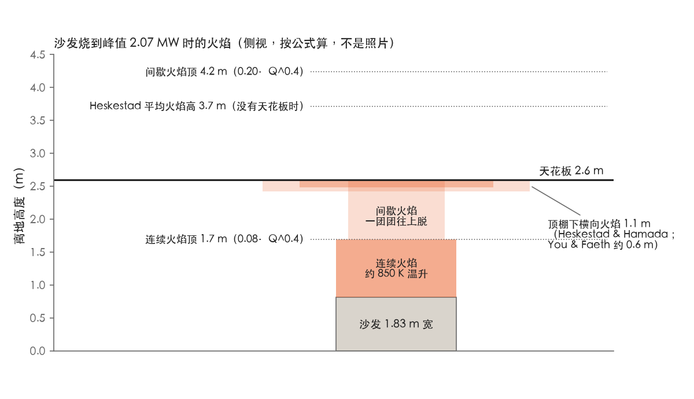
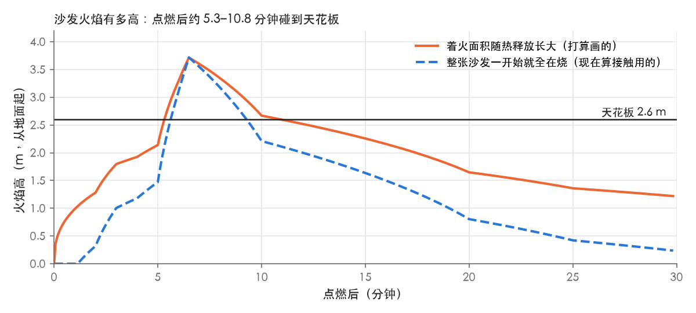

# 真实火焰长什么样，引擎里打算怎么画

2026-11-10 写。起因：Billy 跑页面时，东西烧着了也看不出在烧。B（燃烧）之前只给家具表面染了一层颜色，没有画火焰。这份文档先说真实的火焰长什么样（每条都带出处），再说打算怎么画、要花多少，最后列出要别人改的地方。

**标记：** **[原文]** 读过原文；**[转引]** 是从综述或搜索摘录里看到的，没有对过原文；**[算]** 是用有出处的数自己算的；**[估]** 是为了画面定的数，没有测量依据。

## 一句话

家具火焰是**烟灰颗粒被烧到约 1300 K 发出的光**，所以是橙黄色，不是蓝色。

从下往上分三段：

1. **贴着燃烧面的一段连续火焰。**
2. **一团团往上脱开、每秒跳一两次的间歇火焰。**
3. **最上面看不见火、只有热气和烟的羽流。**

沙发烧到峰值 2 MW 时，火焰平均高约 3.7 m，比 2.6 m 的天花板高，于是会**贴着天花板往外铺约 1 m**。

画法：

- 每团火画 2–3 张面片。噪声往上流，颜色按温度来，跳动频率按尺寸来，碰到天花板就往外铺。
- **不加第二个体积渲染 pass。**

浓烟层会从上往下把火挡住，这是真实的现象。要从上面看见，只能让烟层底被火照亮。这一步要改 smoke-pass.js，不归 B。

---

## 一、现在页面上为什么看不见火

| 现在有的 | 在哪 | 问题 |
|---|---|---|
| 家具表面染色：烧时暗红到橙黄，受热偏棕，烧完和熄灭后炭黑 | `combustion.js` 第 377–432 行 | 只是给家具换颜色，没有火焰的形状 |
| 火上方最热的那团烟带一点火光色 | `smoke-pass.js` 第 175–178 行 | 阈值很高，家具火不一定到得了 |
| 勾上 Flux 热流后，在烧的家具变成纯白 | `radiation.js` 第 377–386 行 | 盖住了 B 的染色 |
| 卡片上的「状态 燃烧」和当前 kW | `card.js` | 只是文字 |

另外两个原因：

- 场景先画，烟后叠上去（`smoke-pass.js` 开头的说明），所以挡在家具前面的浓烟会把底下的东西压暗。
- 关掉「家具」勾选框时，染色也一起隐藏。

## 二、真实的火焰

### 2.1 颜色从哪来

- **发光的是烟灰。** 碳氢燃料烧得不完全，生成烟灰颗粒；颗粒被烧热后像小黑体一样发光，这就是火焰的黄光（Modest，*Radiative Heat Transfer* 附录 D [转引]）。家具里的泡沫、木头、布全都是这种「发光火焰」。
- **温度约 1300 K。** McCaffrey 1979 测的火焰区里，热电偶读数约 1000 K，因为它向外辐射散热，读数偏低；他估计真实的气体温度约 1300 K，误差约 20%（NBSIR 79-1910 第 5 页 [原文]）。他的连续火焰区温升公式算出来约 850 K 温升（见 2.2），和热电偶读数对得上 [算]。
- **1300 K 的黑体是深橙色。** 人眼和相机里火焰看起来是黄色甚至发白的芯，是因为它太亮，超出了感光范围，红、绿通道都顶满了 [估：摄影常识，不是燃烧文献]。画的时候用同一个办法：先按温度取黑体色，再乘一个曝光值，然后截断到 1。最亮的地方自然变成黄白色，边缘和尖端是橙红色。
- **火焰底部中间不发光。** 燃料出来的地方太富燃料，「能看到燃烧面正上方有一个锥形的不发光核，外面包着一层火焰」（McCaffrey 1979 第 7 页 [原文]）。

### 2.2 三段：连续、间歇、羽流

McCaffrey 1979 用 0.3 m 见方的天然气燃烧器，在 14.4–57.5 kW 下测了火焰中心线的速度和温度。他发现所有火的大小都能按 z/Q^(2/5) 归到同一条曲线上（第 7–8 页，表 1 [原文]）：

| 段 | z/Q^(2/5)（m/kW^(2/5)） | 中心线速度 | 中心线温升 | 看起来 |
|---|---|---|---|---|
| 连续火焰 | < 0.08 | V = 6.8 · z^(1/2) | 不随高度变，约 850 K [算] | 一直有火 |
| 间歇火焰 | 0.08–0.20 | V = 1.9 · Q^(1/5)，不随高度变 | 和高度成反比 | 「一团团火焰以每秒几次的频率从连续火焰区往上升」 |
| 羽流 | > 0.20 | V ∝ z^(−1/3) | ∝ z^(−5/3) | 不发光，只有热气和烟 |

温升 850 K 是这样算的：由表 1 的 2gΔT/T0 = (k/C)²(z/Q^(2/5))^(2η−1)，代入火焰区的 k = 6.8、η = 1/2、C = 0.9、T0 = 293 K，得 ΔT = (6.8/0.9)² × 293 / 19.6 ≈ 853 K [算]。

### 2.3 多高，碰到天花板怎么办

- **平均火焰高**用 Heskestad 公式：L = 0.235·Q^(2/5) − 1.02·D（L 和 D 用 m，Q 用 kW）。引擎里接触点燃本来就用它（`combustion.js` PARAMS.flameHeight，和 radiation.js 一致）。这个「平均高」的意思是：在这个高度上，一半时间有火、一半时间没有。
- **A102 沙发 e159 在峰值时**：Q = 2.07 MW，D = √(4 × 1.83 × 0.66 / π) = 1.24 m，所以 L = 3.7 m；连续火焰顶 0.08·Q^(2/5) = 1.7 m，间歇火焰顶 0.20·Q^(2/5) = 4.2 m [算]。天花板在 2.6 m（从网格量的）。
- **碰到天花板以后，火焰沿天花板往外铺。** Heskestad & Hamada 1993 实测的「顶棚下火焰半径」大致等于「没有天花板时的火焰高 − 天花板高度」；You & Faeth 1979 的结果约为它的一半。Karlsson & Quintiere 认为后者适用于小火、前者适用于大火 [转引]。沙发峰值时这个半径是 3.7 − 2.6 = 1.1 m，按 You & Faeth 是 0.6 m [算]。画的时候用前者，因为沙发是大火。
- **靠墙、在墙角，火焰会更高。** Heskestad 公式不适用于靠墙或墙角的火 [转引]。这一条暂时不画（见第六节）。

点燃后约 5.3–10.8 分钟，沙发的火焰会碰到天花板（按着火面积长大来算，见 2.5）[算]。

### 2.4 跳动

- 间歇段的火焰「每秒几次」一团团往上脱开（McCaffrey 1979 第 7 页 [原文]）。
- 频率只跟燃烧面的大小有关：**f ≈ 1.5 / √D**（f 用 Hz，D 用 m）。这个关系出自 Cetegen & Ahmed 1993，后来 Xia 等 2018（arXiv 1803.10400）用它对照了各种池火的数据 [原文：后者引用前者的公式]。

| 东西 | D | 每秒跳几次 [算] |
|---|---|---|
| 沙发 e159（全部着火时） | 1.24 m | 1.3 |
| 大茶几 e162 | 1.46 m | 1.2 |
| 小茶几 e160 | 0.69 m | 1.8 |
| 厨房地柜 e151 | 0.89 m | 1.6 |

### 2.5 火在一件家具上从一处铺开

- 真实的沙发不是一下子整张着起来的：先在被点的那一角起火，再往外铺（`燃烧蔓延与材料损坏.md` 1.1 节，逆风和顺风两种蔓延）。
- 引擎只有总热释放 Q(t)，没有算火在家具上走到了哪里。所以**假设单位面积放热一直等于峰值时的值**，着火面积就是 平面面积 × Q / Q峰值。它从点燃的那一点（离点燃它的那团火最近的地方）开始长，最多长满整张平面；过了峰值，Q 往下掉，着火面积也跟着缩，相当于先烧完的地方先灭 [估]。
- 这样一来，火焰高要按**着火面积**的 D 来算。火刚起时 D 小、火焰窄而尖；到峰值时铺满整张，火焰宽而高。

### 2.6 烟和火

- 火焰尖端往上就是黑烟。烟由 B 按「烧掉的质量 × 产烟率」写进场里，这一条已经在做了。
- **烟层厚了，从上面往下看会把火挡住。** 这是真的：消防员进屋看到的往往是天花板下的一层黑烟，火在下面。真实场景里能看到的，是**烟层的底被下面的火照成橙色**，以及烟里偶尔窜出的火舌，也就是「滚燃」前的征兆（伊利诺伊大学消防学院 *Where There's Smoke There's Fire Behavior* [转引]）。
- 我们的相机大多从上往下、斜着看，正好隔着烟层。所以即使把火焰画了，浓烟时从上面也会看不清。要解决这一点，得让烟层被火照亮，见第五节。

## 三、打算怎么画

每一条都对应第二节里的一条现象。

| 现象 | 画法 | 依据 |
|---|---|---|
| 火焰的身子（侧面看） | 一张竖直的面片，绕竖轴转、始终朝向镜头；宽度取着火区在视线垂直方向上的投影宽，从燃烧面底部画到 2L − 连续火焰高（平均高 L 处正好一半时间有火，上下对称）| 2.3、2.2；面片顶的取法 [估] |
| 从上往下看 | 着火区上方再加一张水平面片，画同样的翻滚火焰 | 竖片从正上方看会缩成一条线；这一张是为了俯视 [估] |
| 一段一段 | 片元里用噪声决定「这一点此刻有没有火」：连续火焰段一直有，往上越来越少，到 L 正好一半时间有，到顶为零 | 2.2 McCaffrey；2.3 Heskestad 的「平均高」定义 |
| 往上窜 | 噪声以间歇段的速度 V = 1.9·Q^(1/5) m/s 往上流 | 2.2 McCaffrey 表 1 |
| 跳动 | 整团火的高度以 f = 1.5/√D 的频率起伏 | 2.4 Cetegen & Ahmed |
| 颜色 | 高度 → 温升（连续段 850 K，往上按 1/z 降）→ 黑体色 → × 曝光 → 截断；边缘火焰薄，再暗一点、红一点 | 2.1、2.2 |
| 底部中间发暗 | 燃烧面正上方中间的一小段降低亮度 | 2.1 McCaffrey 的「不发光核」|
| 从一处铺开 | 着火区从点燃点开始按 平面 × Q/Q峰值 长大，火焰宽和高都按它来 | 2.5 [估] |
| 碰天花板 | 竖片在天花板处截断；天花板下加一张圆片，半径 L − H | 2.3 Heskestad & Hamada |
| 房间被照亮 | 2 盏常驻的点光源，给当下最大的两团火，暖橙色，强度随 Q 和跳动变化 | 真实感最强的线索之一；**先量成本，太贵就拿掉** |
| 烧过的地方 | 保留现有的表面染色：发红 → 炭黑 | 已有 |

**画面上的细节：** 叠加混合（越叠越亮，和发光一致）、不写深度、受剖切面裁切、在 renderOrder 4（在 B 的染色和 C 的热流染色之上）。动画按真实时间走，不按模拟时间，所以暂停时火焰也在动，模拟慢时火焰也不会变成慢动作。

## 四、预算

- **不加体积渲染 pass。** 火焰是面片，不在体素里走光线，符合「只有一次体积渲染」。
- **最多 16 团火同时画。** 网格和材质在启动时一次建好；每帧只改 uniform（位置、大小、时间、Q），不分配新内存。
- **片元成本：** 每个像素算 3 层噪声。火焰在屏幕上只占一小块，16 团全开也只是全屏的一小部分 [估]。
- **点光源：** 会让全屋所有 Lambert 材质每个像素多算两盏灯。灯在启动时就加进场景、强度先设为 0，这样不会因为灯的数量变化而重编译 shader。这是唯一可能明显变贵的部分，做完先量：开灯和关灯各跑一次，比较帧时间。
- **CPU：** 每次 report 遍历在烧的东西（≤16 个），算几个数，和现在的染色同一个量级（燃烧模块现在平均 0.13 ms/步）。
- 页面整体 117 ms/步、机器发烫的大头不在燃烧模块；火焰不会让它明显变差，做完会给出前后的数。

## 五、要别人改的（不归 B，先问）

1. **烟层被火照亮（smoke-pass.js，主引擎 / T0）。** 在烟的光线行进里，加上「最近的几团火的光」：每个采样点按到火的距离算一个衰减的橙光。这是从上面隔着烟看见火的唯一真实办法。成本是每个采样点多算几次距离，要在 Mac 上量过才知道能不能加。
2. **火焰画在烟之后（main.js）。** 现在场景先画、烟后叠，火焰会和家具一样被烟压暗，这是真实的。如果想要「无论烟多厚都看得见火」的教学模式，就得在烟之后再叠一次火焰（多一次很小的绘制）。这个要 Billy 决定：要真实，还是要看得清。
3. **接触点燃要不要也改用着火面积（combustion.js，B 自己的）。** 现在算「火焰碰到旁边的东西」时，用的是整张平面的火焰盒子（图 2 的蓝线）。画面改成着火区慢慢长大以后，物理也跟着改才一致，但会让旁边的东西晚一点被点着。这一条改了会动检查结果，所以先问。

## 六、没做的 / 假设

- 靠墙、墙角的火焰更高：不画。
- 着火面积 = 平面 × Q / Q峰值 [估]：单位面积放热一直取峰值时的值，没有测量依据。
- 面片顶取 2L − 连续火焰高 [估]。
- 曝光值、噪声的样子、边缘变暗的程度 [估]：都是看着调的。
- 火焰旁边的热气扭曲（热霾）：不画，要读屏幕再扭一遍，额外多一次全屏 pass。
- 风把火焰吹斜：暂时不画。场里有风速，以后可以按火焰底部的风让面片倾斜。

## 来源

- McCaffrey, B. J. (1979). *Purely Buoyant Diffusion Flames: Some Experimental Results.* NBSIR 79-1910. https://nvlpubs.nist.gov/nistpubs/Legacy/IR/nbsir79-1910.pdf ：第 5、7、8 页，表 1 [原文]
- Cetegen, B. M., & Ahmed, T. A. (1993). Experiments on the periodic instability of buoyant plumes and pool fires. *Combustion and Flame* 93, 157–184。公式 f = 1.5/√D 引自下一条 [转引]
- Xia, X., & Zhang, P. (2018). Flickering of buoyant diffusion flames: a vortex dynamics revisit. https://arxiv.org/pdf/1803.10400 [原文]
- Heskestad, G. 火焰高公式，引擎里的 PARAMS.flameHeight（出处见 radiation.js 和 `家具着火数据.md`）
- Heskestad, G., & Hamada, T. (1993). Ceiling jets of strong fire plumes. *Fire Safety Journal* 21；You, H. Z., & Faeth, G. M. (1979)；Karlsson & Quintiere (1999) *Enclosure Fire Dynamics* 的比较。均为 [转引]，来自 core.ac.uk/download/326445403.pdf、core.ac.uk/download/287021783.pdf 和 UiS 硕士论文（brage.unit.no 11250/2385278）的摘要
- Modest, M. F. *Radiative Heat Transfer*，附录 D（thermalradiation.net）：烟灰是发光火焰的光源 [转引]
- Illinois Fire Service Institute, *Where There's Smoke There's Fire Behavior*：滚燃时烟里窜出火舌 [转引]
- 引擎里的数：沙发曲线来自 NIST TN 2303 第 40 次实验（materials.json）；沙发、茶几、地柜的尺寸和天花板高度从网格量得（tools/flame-figures.py）
