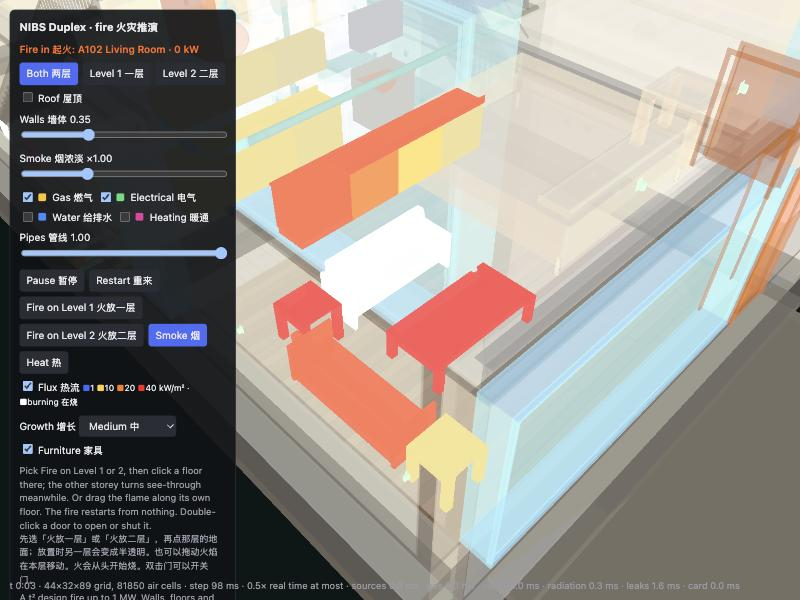
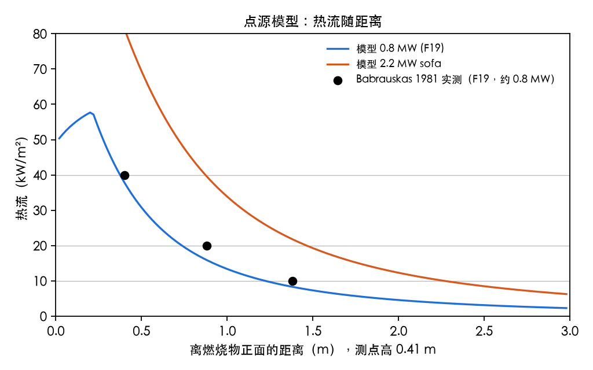
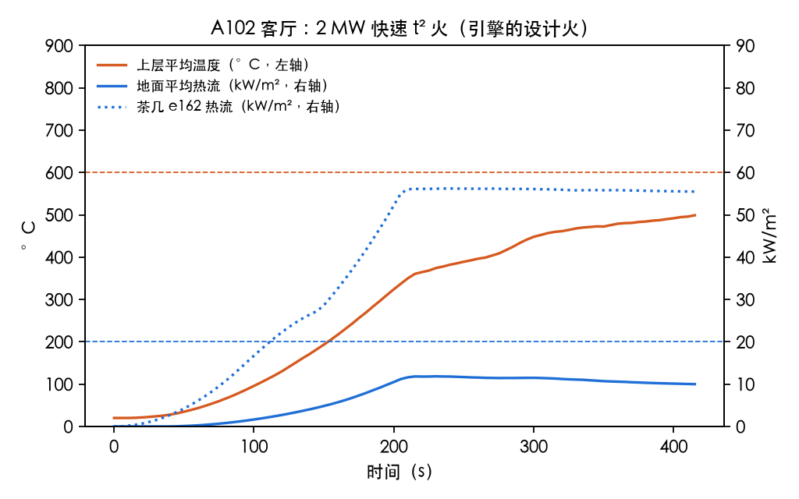

# C 辐射与轰燃：第一版做完（2026-11-10）

## 一句话

燃烧的东西现在会「烤」周围的物体：每件物体每一步都会算出它表面受到的热流（`flux`，kW/m²），B 拿这个数去判断点不点着。房间里热到轰燃时，整间房的可燃物一起点着。这套模型和 Babrauskas 1981 的实测对过：差 10–20%，算出来的距离偏近一点。

## 做了什么

- **`duplex-fire/src/radiation.js`（新）**：辐射、轰燃、按热流给家具上色的开关。world 会自动加载它，没改 main.js，也没改别人的文件。
- **`duplex-fire/tools/radiation-check.mjs`（新）**：下面「检查了什么」里的数都是它跑出来的：`node tools/radiation-check.mjs 420`。它把结果写进本文件夹的 `radiation-check.json`，图由这份 json 画出。
- **每个数的来源**写在 radiation.js 开头的 `PARAMS` 里，格式和 materials.json 一样（`{ value, unit, source }`）。控制台里是 `duplexFire.world.radiation.PARAMS`。我没有往 materials.json 里加，因为它是好几个任务共用的文件；要搬进去的话，跟 T0 说一声。

### 热从哪来：两种

**1. 正在烧的东西，当成一个点。**

- 一件物体放出的辐射 = 它此刻的热释放 × 辐射分数。热释放由 B 写进 `hrr`，辐射分数从 materials.json 读，沙发和床是 0.4。剩下的 60% 进了空气，由 B 写进场里。
- 物体表面收到的热流 = 辐射 × cosθ ÷ (4πR²)。R 是到那个点的距离，θ 是这个面和来热方向的夹角。这是 Modak 的点源模型，CFAST 和 NUREG-1805 第 5 章都用它。
- **这个点放在哪：** 在燃烧物正中那条竖线上，火焰高度的 1/3 处（CFAST 的做法）。火焰高度按 Heskestad 公式由热释放和底面大小算出，碰到天花板就截断。
- **火焰从哪算起：** 从燃烧物的底面算起，不从顶面。理由有两个：
  - NIST TN 2303 记录到，泡沫熔化后会在沙发底下形成一池燃烧的液体。
  - 我试过从顶面算起：点会在座面上方一米多，旁边的家具几乎是侧着对着它。那样的话，Babrauskas 实验里最大的那个火（约 0.8 MW）离开 5 cm 就点不着任何东西了，和实测差得很远。
- **离得太近时：** NUREG-1805 说，点源模型只在距离大于 2.5 倍火直径时准，更近就会越算越大。所以我规定 R 不能小于火的半径（**假设**），意思是目标离火焰中心的距离，不会比火焰边缘还近。
- 物体朝外的五个面（底面除外）**各算一遍，取热流最大的那个面**。
- **遮挡：** 墙、楼板、关着的门会挡住辐射：每对热源和物体之间，沿网格走一条线，碰到实心格子就不算。家具不挡别的家具（**假设**）。
- 拖动放的引火源也算一个热源，它的大小和辐射分数从 HouseFire 读。B 把它改小以后，这里不用改。

**2. 天花板下的热烟层。**

- 照 CFAST 的做法，从物体顶面往上一格一格走到天花板。每一格空气按自己的温度往下发热（σT⁴），同时把上面传下来的热挡掉一部分。挡多少看烟灰浓度，用的是 CFAST 的烟灰吸收公式：κ = 1195.5 · f_v · T。
- 每格的路程乘 1.8：这是 CFAST 用一条竖线代表整层烟时用的系数。
- **侧面只收一半：** 竖着的面只看得到上方一半的天空。数学上，竖直面到它上方无限大平面的视角系数正好是 1/2。
- **漏算的两样，都会让烟层的热算少：**
  - 热的天花板和墙本身也会往下发热。但墙的温度没人记，所以这一项没算。
  - 烟里的 CO2 和水蒸气也会吸热、发热，这里只算了烟灰。烟稀的时候，这两样漏算得最明显。

**物体表里新增的字段：** `o.flux` 是总热流。另外多写了两个字段 `o.fluxFlame` 和 `o.fluxSmoke`，是那个最热的面上，来自火焰和来自烟层的各多少。A 的卡片想分开显示的话可以用。

**埋在墙里、楼板里的物体**（`wallAir`），算它们收到的热流是 0，因为墙替它们挡住了。

### 轰燃

- 每个房间每 0.5 s 检查一次，两个读数：
  - **上层温度**：房间上面 1/3 所有空气格子的平均温度。
  - **地面热流**：地面上取 3×3 九个点，算烟层和火焰一起照到地面的热流，取平均。
- **上层到 600°C，或者地面到 20 kW/m²，就算轰燃。** 这两个是 NIST 常用的两个判据。
  - 注意：41 CFR 102-80.145 的定义是两条**同时**满足，这里用的是任一条满足。原因是开工顺序里写的是「或」；另外我们的模型漏了热天花板，地面热流会偏低，要两条都满足会更晚才轰燃。要改成「同时满足」，改一个词就行。
- 轰燃时：
  - 发一个 `轰燃` 事件。事件里带上：哪个房间、当时的温度和热流、是哪一条判据触发的、房间里有几件可燃物。
  - 再对房间里每件可燃物调 `world.ignite`。房间里的东西按物体表的 `room` 字段认。
- 每个房间只会轰燃一次。点「重来」以后会复原。
- 控制台：`duplexFire.world.radiation.status()` 列出每个房间此刻的上层温度、地面热流，以及是否已经轰燃。

### 按热流上色

- 「Heat 热」按钮旁边多了一个「Flux 热流」开关。打开以后，每件家具按它收到的热流上色：
  - 1 kW/m² 蓝
  - 10 kW/m² 黄（实木茶几的临界点燃热流）
  - 20 kW/m² 橙（大多数家具）
  - 40 kW/m² 及以上红（难燃）
  - 正在烧的东西是白色
  - 不到 1 kW/m² 的不上色
- 上色的做法是给家具罩一层颜色，没有加新的体积渲染。每 5 步刷新一次。「Furniture 家具」的勾去掉以后，这层颜色也一起隐藏。

## 你在页面上能看到什么



- 上图是在控制台里把 A102 客厅的沙发 e159 设成 2.2 MW 在烧，然后打开「Flux 热流」：
  - 沙发本身是白色。
  - 前面的大茶几（离开 0.6 m）和旁边的小茶几（0.18 m）是红色。
  - 转角的另一张沙发是橙色。
  - 开放式厨房的柜子，从近到远由橙变黄。
- 要等 B 做完，家具才会真的自己烧起来。在那之前，可以在控制台里这样试：

```js
const w = duplexFire.world, sofa = w.objects.byId.get('e159');
sofa.hrr = 2.2e6; sofa.state = '燃烧';   // 假的：B 做好以后不用这样
```

## 检查了什么

所有数字都是 `node tools/radiation-check.mjs 420` 跑出来的，原始结果在 `radiation-check.json`。

### 1. 和 Babrauskas 1981 的实测对比（NBSIR 81-2271，表 2）

做法：

- **实验：** Babrauskas 烧了一批家具，在离家具 0.05–1.73 m、高 0.41 m 的地方放热流计，记下 10、20、40 kW/m² 三个热流各自最远到达多远。
- **模型这边的设置：**
  - 用同样高、同样朝向的测点。
  - 热释放 = 表里的峰值质量损失速率 × 燃烧热。燃烧热取 15.6 / 17 / 18.5 MJ/kg 三个值，是 NIST TN 2303 测的沙发范围；下表写的是取 17 时的结果，括号里是这三个值算出的范围。
  - 辐射分数 0.4。
  - 试件的尺寸原文没给，我用沙发大小的盒子代替长椅和双人沙发，用扶手椅大小的盒子代替各种椅子（**假设**）。

| 试件 | 峰值（g/s，约 MW） | 测点方向 | 实测：10 / 20 / 40 kW/m² 最远到（m） | 模型（m） |
|---|---|---|---|---|
| **F19 医院长椅**（最大的一个） | 47，约 0.8 | 正面 | **1.38 / 0.88 / 0.40** | **1.22 / 0.74 / 0.37**（1.16–1.28，0.70–0.77，0.36–0.39） |
| F05 双人沙发 | 36，约 0.6 | 侧面 | 0.93 / 0.54 / 0.44 | 0.46 / 0.04 / 0.00 |
| F04 扶手椅 | 27，约 0.46 | 侧面 | 0.50 / 0.29 / 0.14 | 0.79 / 0.42 / 0.16 |
| F16 安乐椅 | 22，约 0.37 | 侧面 | 1.33 / 0.79 / 0.20 | 0.68 / 0.36 / 0.13 |
| F17 椅子 | 20，约 0.34 | 侧面 | 1.37 / 0.44 / 0.20 | 0.64 / 0.33 / 0.11 |
| F17 椅子 | 18，约 0.31 | 正面 | 0.74 / 0.43 / 0.10 | 0.58 / 0.30 / 0.09 |
| F15 扶手椅 | 12，约 0.2 | 侧面 | 0.84 / 0.29 / 0.12 | 0.40 / 0.17 / 0.00 |



怎么读这张表：

- **F19 是开工顺序指定要对的那个，差 10–20%，模型算出的距离偏近。** 40 kW/m² 几乎完全对上（0.37 vs 0.40 m），10 和 20 kW/m² 近了 0.15 m 左右。
- **两张对比都是测点正对着家具的，对得最好。** 测点在家具侧面的几次，实测本身就很散：两件差不多大的火，一件的 10 kW/m² 到 1.37 m，另一件只到 0.50 m。Babrauskas 自己的解释是，有的家具烧得很敞开，有的会自己挡住自己。
  - 模型对侧面多半算近了，但也有一件算远了（F04）。
  - 双人沙发 F05 算得最差：我用的是 1.83 m 长的沙发盒子，测点在它的端头，离火焰中心太远。真的双人沙发要短一些。
- **结论：** 「沙发烤着茶几」这一步的数量级有依据；模型给的距离偏保守（偏近），会让火传得慢一点，不会传得过快。
- 图里 0.8 MW 那条线在最近的 0.2 m 内往下弯，是因为「R 不小于火的半径」这条假设限住了。离得这么近，实际上已经是火焰直接碰到了。

**模型对 Duplex 自己的几件家具（各按实测峰值）：**

| 家具 | 峰值 | 10 / 20 / 40 kW/m² 到多远（正面，m） |
|---|---|---|
| 沙发（NIST test 40） | 2.2 MW | 2.26 / 1.46 / 0.87 |
| Queen 床（test 38） | 4.6 MW | 3.01 / 1.87 / 1.06 |
| 高柜（NBS 61） | 1.9 MW | 2.12 / 1.37 / 0.82 |

这些是外推：Babrauskas 测过的火最大只有约 0.8 MW，2 MW 以上没有实测可以对。

### 2. 烟层：算法和公式对得上

一层均匀的 600°C 烟压在地面上：

| 烟灰（g/m³） | 厚（m） | 发射率 | 地面热流（kW/m²） | 手算 |
|---|---|---|---|---|
| 0.3 | 1.0 | 0.27 | 8.7 | 8.7 |
| 1 | 0.4 | 0.34 | 11.1 | 11.1 |
| 1 | 1.0 | 0.65 | 21.1 | 21.1 |
| 3 | 1.0 | 0.96 | 31.1 | 31.1 |
| 10 | 2.0 | 1.00 | 32.5 | 32.5（600°C 黑体） |

- 1 g/m³、1 m 厚时地面约 21 kW/m²，和《家具着火数据.md》估算的「1 g/m³ 的烟大约 0.9 m 厚，地面到 20 kW/m²」一致。
- 这只说明代码照公式算对了，**不是**拿实测验证烟层模型。

### 3. 在 Duplex 里：沙发 e159 烧到 2.2 MW 时（假的热源，空气是冷的）

| 物体 | 离沙发 | 热流（kW/m²） | 它的临界点燃热流 |
|---|---|---|---|
| e162 大茶几 | 0.60 m | 63.0 | 10，超过 |
| e160 小茶几 | 0.18 m | 54.3 | 10，超过 |
| e158 转角沙发 | 0.46 m | 33.5 | 16，超过 |
| e152 厨房柜 | 1.13 m | 33.3 | 18，超过 |
| e151 厨房柜 | 1.13 m | 25.8 | 18，超过 |
| e150 厨房柜 | 1.33 m | 11.0 | 18，不到 |
| e161 角落小茶几 | 2.10 m | 7.9 | 10，不到 |

- A102 和厨房 A103 是开放的，所以厨房的柜子也收得到热。
- 二楼没有收到热：楼板挡住了。唯一的例外是 e622，一根从一楼天花板下穿上二楼的 PVC 管，收到约 5 kW/m²。
- 大茶几（0.60 m）比小茶几（0.18 m）收到的还多，原因是：
  - 「离沙发」量的是盒子到盒子的最近距离。
  - 热流取决于到火焰中心那个点的距离和角度。大茶几正对着沙发的长边；小茶几在沙发端头，离沙发中心更远。

### 4. 在 Duplex 里：客厅一场 2 MW 的设计火，跑 7 分钟

用的是引擎现有的 t² 火：快速增长，约 206 s 到 2 MW，放在沙发 e159 的位置。门全开，还没有 B，所以家具不会被点着。



- **7 分钟内没有轰燃。** 上层温度升到约 500°C，地面热流最高约 12 kW/m²。
- **这个结果说得通：** A102 和厨房、门厅是连通的大空间，门也都开着，单靠一个 2 MW 的火，热量会散开。真正的轰燃要等 B 接上：沙发、茶几、转角沙发一件件被烤着，几件加起来有好几 MW。
- **地面热流大部分来自火焰本身，烟层贡献很小。** 茶几收到的热里，烟层只占约 2.6 kW/m²。这正是上面「漏算的两样」造成的偏低：热天花板和 CO2、水蒸气都没算。所以真到轰燃，在我们的模型里多半是由「上层 600°C」这条先触发。
- **茶几 e162：** 火到约 110 s（570 kW）时，它收到的热流超过 20 kW/m²，到 2 MW 时约 56 kW/m²。等 B 接上，它会在这一段时间里被点着。

### 5. 轰燃规则本身

把客厅上面 1/3 的空气直接设成 600°C，然后让规则判断一次：

- 发出一个轰燃事件：A102 Living Room，由「上层温度」触发。
- 客厅里 6 件可燃物都调了 `world.ignite`：两张沙发、三张茶几、一扇木门。
- 别的房间没有受影响。
- 地面热流这次是 0，因为设的是干净的热空气，没有烟灰。模型里只有烟灰会发热；这正是上面说的「不算 CO2 和水蒸气」那条假设。

### 页面里试过

- 页面正常加载，radiation 出现在状态行里，没有报错。
- 打开「Flux 热流」开关，颜色和上面第 3 节的数一致（截图见上）。
- 点「重来」以后：所有热流归零，沙发回到「完好」，轰燃记录清空。

## 每步耗时

| 情况 | radiation.js 每步 |
|---|---|
| 页面里，沙发 2.2 MW 在烧（60 步） | 平均 0.35 ms，95% 的步在 1.2 ms 以内，最多 1.6 ms |
| node 里，客厅 2 MW 的火跑 420 s（8400 步） | 平均 0.37 ms，95% 的步在 0.80 ms 以内；最多一次 27.9 ms（只出现一次，多半是垃圾回收或刚开始的编译） |

- 预算是所有机制加起来 10 ms，辐射平均用掉不到 0.4 ms。
- 省时间的做法：
  - 只给有烧着的东西的时候算火焰那一项。
  - 烟层每 4 步才算一次；物体正上方天花板下那一格不热，就直接跳过。
  - 轰燃每 10 步才查一次。
  - 竖列和房间的格子开始时就找好，之后不再重新找。
- 当时求解器每步是 60–80 ms，比平常的 43 ms 慢，是因为跑这些时，旁边同时开着页面和别的检查。

## 假设（汇总）

- 火焰从燃烧物底面算起；点源在火焰高度的 1/3 处（CFAST）。
- R 不小于火的半径。
- 家具不挡家具的辐射。
- 烟层：只算烟灰，不算 CO2 和水蒸气；不算热天花板和墙。
- 侧面收到烟层的一半。
- 上层 = 房间上面 1/3；地面热流取九个点的平均。
- 轰燃判据用「或」，不用 41 CFR 的「且」。
- 埋在墙里的物体不受辐射。
- 烟层每 0.2 s 更新一次，房间每 0.5 s 检查一次。

## 还差 / 要别人做的

- **B：** 读 `o.flux` 来判断点燃。B 做好后，要整套跑一遍：沙发着火 → 茶几被烤着 → 客厅轰燃。这一步还没做，因为现在没有 B。
- **开工顺序里的检查写法要改一处：** 写的是「2 MW 左右的火能点燃 0.44–0.88 m 内的物体」。原文（NBSIR 81-2271 第 28 页、表 2）的意思不是这样：
  - 在所有试件里，40 kW/m² 最远测到 0.44 m，20 kW/m² 最远测到 0.88 m。
  - 最大的那个试件（F19，医院长椅）峰值是 47 g/s。按沙发的燃烧热 15.6–18.5 MJ/kg 换算，约 0.73–0.87 MW，不是 2 MW。
  - 所以我拿 F19 来对，2 MW 的结果只作为模型的预测列出来。
- **热天花板：** 等有人记墙和天花板的温度，就可以加进烟层那一项。现在不加，家具受到的热偏低。
- **A（卡片）：** 如果想在卡片上分开显示「火焰 / 烟层」各多少，可以读 `fluxFlame`、`fluxSmoke`。
