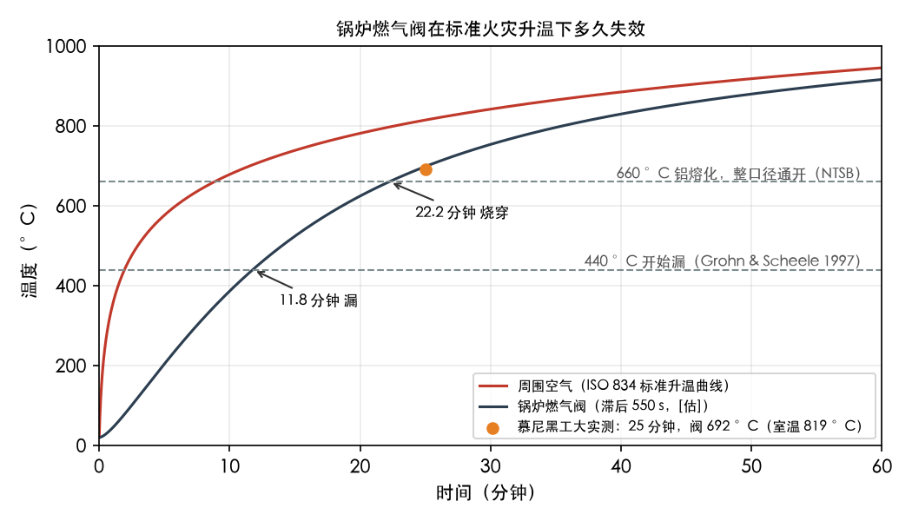
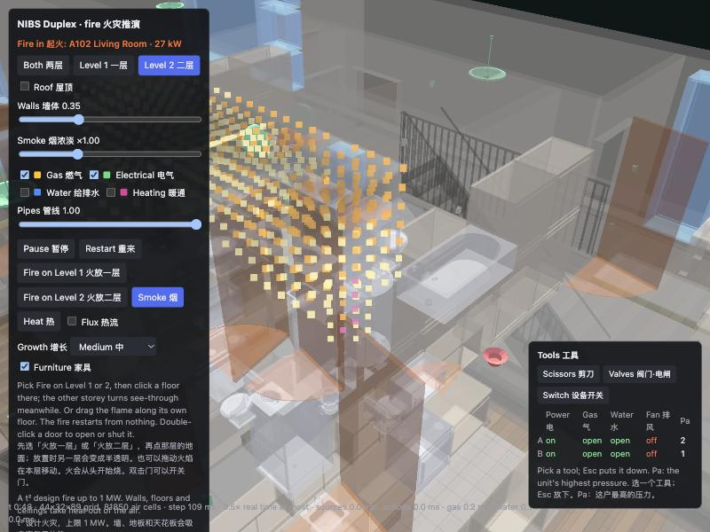
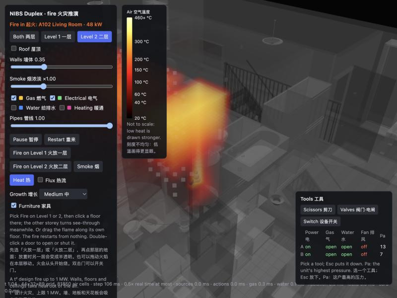
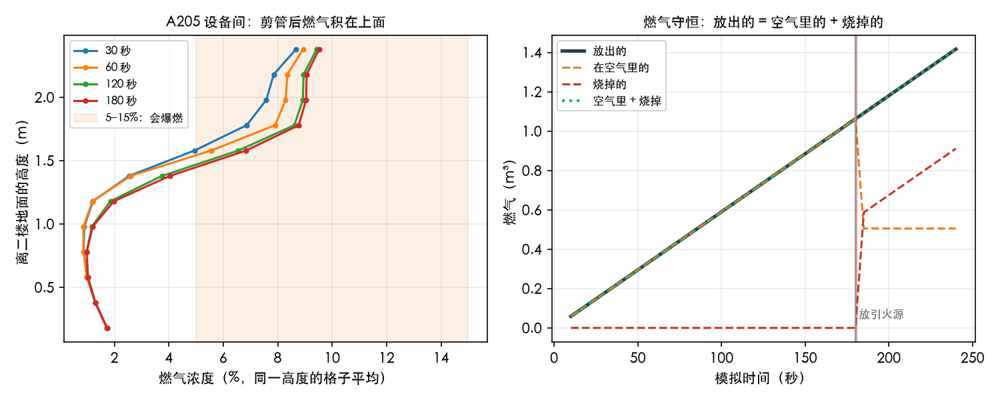

# D 燃气：第一版做完（2026-11-10）

## 一句话

燃气现在是场里的一个量：剪开一根管，燃气从破口一直往外放，往上飘，积在天花板下；它碰到火，只有浓度在 5–15% 之间的那一片会一下烧掉（爆燃）；破口本身被点着后，就变成一个持续的燃气火，只有关阀才停。锅炉的燃气阀被烤到 440 °C 开始小漏，烤到 660 °C 整个烧穿。

## 做了什么

- **`duplex-fire/src/gas.js`（新）**：燃气管线、流量、燃气场、浮力、爆燃、持续燃气火、锅炉燃气阀失效、关阀、画法、控制台函数。world 自动加载，没改 main.js。
- **`materials.json` 里燃气的几条**：`gas_pipe` 加了管径、摩擦、出口系数；新加 `gas_supply`（燃气网）、`gas_mixture`（燃气和空气）、`gas_appliance_valve`（锅炉燃气阀）。每个数都有来源或标「假设 / [估]」。
- **`duplex-fire/tools/gas-check.mjs`（新）**：下面「检查了什么」里的数都是它跑出来的：`node tools/gas-check.mjs all 180`。

## 模型里有什么、没有什么

- **有：** 两户各一路燃气管，一共 10 段管子、8 个弯头。从西墙外、地面下约 0.67 m 进户，走地下夹层（不在模拟网格里），从厨房旁边的墙里竖上去，到二楼设备间（A205、B205）接锅炉。
- **没有：** 燃气表、调压器、总阀、锅炉自带的燃气阀。按你定的（2026-11-10）：
  - **入户端当表和总阀**（假设位置）：关阀就是关这里，整户停气。它在网格外，火烤不到。
  - **锅炉接口当会被烤坏的部件**（假设位置）：每户管线的最后一段（A 户 e1034，B 户 e1031），在设备间里，火烤得到。

## 怎么算

### 流量

调压器把表前的压力稳在 7 英寸水柱（1744 Pa），不管流量多大（假设：不掉压）。从这里经过燃气表、沿着管线一路到破口：

- 压力 = 燃气表的损失 + 管道摩擦和弯头的损失 + 破口本身的损失。
- 燃气表的阻力从美国家用燃气表 AC-250 的额定值反推：250 立方英尺/小时时压降 0.5 英寸水柱。
- 同一户开了两个口，它们共用燃气表，所以各自变小。

**算出来：剪断任意一根管，每小时约 21–24 m³，点着后约 200 kW。** 比引火源（几十 kW）大，比一张沙发（2 MW）小得多。这个数**没有实测可对**（没找到剪断家用燃气管的流量测量），只能说它落在三个上限之内：管口按孔口公式算、燃气表、调压器全开。

### 燃气往哪走

- 燃气是一个场，存的是体积分数（0.1 就是 10%），用 `fire.addScalar('gas')` 登记，求解器负责搬运和混合，总量守恒。
- **比空气轻：** 燃气所在的格子被往上推，加速度 = g ×（1 − 0.6）× 浓度。0.6 是天然气对空气的相对密度（美国燃气表和调压器都按这个标定）。这和求解器用温度推热空气是同一种写法。
- 破口喷出的速度（每秒几米）没算进去，燃气只是放进破口旁边的格子（假设）。

### 什么时候烧

**「碰到火」** 指一个格子或它的六个邻格里：

- 有正在烧的燃料（`fire.fuel` ≥ 20 K，假设），也就是引火源或者燃烧的家具在那里；
- 或者空气超过 540 °C，甲烷的自燃温度（Zabetakis 1965，美国矿务局）。

**爆燃：** 浓度在 5–15% 的格子碰到火，火就沿着所有连在一起、也在 5–15% 之间的格子走一遍，这一片的燃气一次烧掉，热量放进 `fire.fuel`，由求解器变成热（最高到火焰温度，烧不完的先随气流带走）。

- 低于 5% 的不烧。
- 高于 15% 的也不烧，等它的边缘被混稀到 15% 以下，边缘那一层再烧（假设：没有模拟浓燃气团表面的扩散火焰）。
- 一次烧掉的燃气超过 0.05 m³（约 1.7 MJ，假设）才报「燃气爆燃」事件。更小的照样烧，只是不报。

**冲开门窗：** 求解器不算压力，所以压力是估的：密闭空间里，一团燃气烧掉后，压力升高 ≈ 7 bar × 这团燃气的体积 / 和它连通的空气体积。7 bar 是燃气充满一个密闭房间时的爆炸压力（Tomlin 等 2015）。这样估是上限，因为没算任何泄压。

- 超过 3 kPa：窗户破（实测 2.1–4.8 kPa，Kiwa 2021 引 Astbury 试验），关着的室内门被推开（假设和窗户一样）。
- 外门推不开：引擎里还没有室外（`doors.js` 的规定）。事件里会列出「本来会被冲开的」门。
- 破了的窗只把状态标成「失效」，因为没有室外，燃气和烟出不去。

**持续燃气火：** 破口处的格子碰到火（或者爆燃烧到了破口），破口就点着，并一直烧下去：之后喷出来的燃气在破口处直接变成热，不再进入场。热释放写在那根管子的 `hrr` 上（瓦）。关阀，火就灭。

### 锅炉燃气阀什么时候坏

- 阀的温度跟着周围空气慢慢升，滞后时间 550 秒。这个数是拿慕尼黑工大的火灾实验反推的：按标准火灾升温曲线（ISO 834），25 分钟时房间 819 °C、阀 692 °C；用 550 秒算出来是 698 °C。
- **440 °C 开始漏：** 德国 1997 年的文献说，锌或铝压铸、带橡胶件的燃气具控制阀「最晚 440 °C 开始漏」。漏量取每小时 0.56 m³，也就是那次实验里调压器的漏量，烧起来约 5 kW。
- **660 °C 烧穿：** 铝在约 660 °C 熔化。NTSB 把熔化的调压器外壳当作「至少到过这个温度」的证据。从这里开始，阀按整根管的口径通开，约 200 kW。
- 加拿大 BC 省的案例就是这样：火把两个燃气具的调压器「整个烧没了」，燃气一直供火，直到消防员关了表阀。

按标准升温曲线，阀在 11.8 分钟开始漏，22.2 分钟烧穿。真实的火只有烧到设备间才会这么热。

## 你在页面上能看到什么

**剪管、积气（还没有火）：** 剪开 A205 设备间里的 e569。燃气从破口往外放，往上飘，积在天花板下。点云的颜色：淡黄是不到 5%，橙色是 5–15%（会爆燃），紫红是超过 15%（太浓，暂时烧不起来）。

**放引火源以后：** 破口先被点着，变成 197 kW 的燃气火；它的火焰柱碰到天花板下那层 5–15% 的燃气，这一层一次烧掉（爆燃）。下图是热成像。关掉 A 户的阀，燃气火灭。

页面里那一次报出的事件（引火源放在第 30 秒）：

- 51.0 秒「燃气点燃」：破口，197 kW。
- 51.9 秒「燃气爆燃」：0.8 m³ 的燃气团，里面有 0.057 m³ 燃气，放热 1.9 MJ；估的压力上限 1.8 kPa，没到窗户破的 3 kPa，所以没有冲开门窗。
- 关阀后 8 秒：不再放气，那根管的热释放回到 0。

控制台里都在 `duplexFire.gas` 下面（也是 `duplexFire.world.gas`）：

| 函数 | 做什么 |
|---|---|
| `cut('e569')` | 剪断一根燃气管，返回每小时多少 m³、点着后多少 kW |
| `leak('e569', 0.05)` | 开一个小漏口，0.05 是开口占管截面的比例 |
| `valve(false)` | 关两户的阀；`valve('A', false)` 只关 A 户；`valve()` 看状态 |
| `pipes()` | 18 件燃气管的编号、哪户、在不在网格里、哪个是入户端和锅炉阀 |
| `status()` | 每个破口的流量、有没有点着 |
| `books()` | 燃气守恒的账 |
| `parts()` | 两个锅炉燃气阀此刻的温度和状态 |
| `peak()` | 场里最高浓度，和处在 5–15% 之间的空气有多少 m³ |
| `show(false)` | 隐藏燃气点云 |
| `fail('A', 2)` | 测试用：让 A 户锅炉阀马上烧穿 |

F 的剪刀和阀门已经接上这几个函数（`actions.js`、`sources.js` 调 `world.gas.cut` 和 `world.gas.valve`）。

**能剪的管：** 18 件里有 8 件在地下夹层，不在网格里（`pipes()` 里 `inGrid: false`）。剪它们，燃气照样流，但流到了房子看不见的地方，记在账上的「网格外」一栏。网格里能剪的是设备间里的几段，和墙里的两根立管（燃气放进墙两边一格半内的空气里）。

## 检查了什么

都在 `node tools/gas-check.mjs` 里，下面的数是它跑出来的。

**1. 燃气守恒：** 剪开 e569，先放 180 秒，再在房间中间放引火源烧 60 秒，最后关阀 10 秒。账（m³）：

| 放出 | 空气里 | 爆燃烧掉 | 破口处烧掉 | 被关门清掉 | 网格外 | 漏到室外 | 对不上 |
|---|---|---|---|---|---|---|---|
| 1.4167 | 0.5053 | 0.5629 | 0.3486 | 0 | 0 | 0 | 约 −4 纳立方米（−3.8e-9 m³） |

整个过程每 10 秒查一次，对不上的部分最多占放出量的 一亿分之 6（6.3e-8，浮点误差）。页面里（加上 F 的漏烟模块一起跑）同样在 1e-8 m³ 量级。

**2. 爆燃只在 5–15% 之间：** 这一场所有烧掉的格子，浓度最低 5.00%，最高 14.82%。浓度高于 15% 的格子（破口旁边最高 31%）一个都没烧。

左图：设备间里各个高度的平均浓度。燃气分层：上面 9%，下面不到 2%。这和 NTSB 的 CFD 模拟、NYSEARCH 的住宅实验一致（都是燃气从天花板往下积），但**只是形状一致，没有逐数对比**：那两个实验的房间和泄漏量和这里不一样。

**3. 这一场的爆燃（node 里，引火源放在第 180 秒）：**

- 0.55 m³ 燃气，在一团 7.8 m³ 的燃气团里一次烧掉，放热 18.5 MJ。
- 燃气团已经从设备间漫到二楼走廊、楼梯、两间卧室和卫生间。估的压力上限 17 kPa，所以这几个房间的 9 扇窗被判破。
- 17 kPa 落在实测的通风情况下家用燃气爆炸峰值（200 mbar = 20 kPa 以下，Kiwa 2021）之内。但它是不算泄压的上限，真实的会低一些。

**4. 流量：**

- 剪断任意一根管：每小时 21.0–23.5 m³，点着约 195–218 kW。离入户端越近，管道损失越小，流量越大。
- 同一户剪两处：A 户总流量从每小时 21.3 m³ 变成 24.8 m³，两处各 12.3–12.5 m³（共用燃气表，所以各自变小）。
- 5% 的小漏口：每小时 4.1 m³，约 38 kW。
- 锅炉阀开始漏：每小时 0.56 m³，约 5 kW；烧穿：每小时 21.0 m³，约 195 kW。
- 关阀：两户流量都变成 0。

**5. 锅炉阀的滞后：** 按标准升温曲线，25 分钟时阀 698 °C，实验是 692 °C（这个数是拿它反推出来的，所以对得上不算验证）。

**6. 页面里：** 加载正常，没有报错；剪管、点着、关阀和 node 里一样。F 的剪刀和阀门调的就是这几个函数。

## 每步耗时

- **燃气在放、没有火：** 每步 0.24–0.28 ms（`world.timings()`，平滑后）。
- **有火、破口在烧：** 每步 0.31 ms。
- **发生爆燃的那一步：** 14.4 ms，一次性的。要沿着连通的空气走一遍整户（约 3.9 万个格子）来估压力，找门窗。每次爆燃只有这一步。
- 没放燃气之前：几乎为 0，只看两个锅炉阀的温度。
- 燃气场的搬运算在求解器里（E 量过，两个额外的量合计约 +1 ms）。
- 点云最多 3 万个点，每 3 步更新一次；没有加新的体积渲染。

## 假设（汇总）

| 什么 | 现在用的 | 依据 |
|---|---|---|
| 表、总阀的位置 | 入户端，网格外 | 假设（模型里没有） |
| 锅炉燃气阀的位置 | 每户管线最后一段 | 假设（模型里没有） |
| 调压器不掉压 | 一直 1744 Pa | 压力有来源（NTSB），不掉压是假设 |
| 燃气表阻力 | 3.22×10⁷ Pa/(m³/s)² | 由 AC-250 额定值反推；数据表没读原文 |
| 管径、摩擦、弯头 | 1 英寸钢管，内径 26.6 mm；f 0.03；K 1 | 外径和 IFC 对得上；其余假设 |
| 剪断后的流量 | 约 21–24 m³/h，约 200 kW | 算出来的，没有实测可对 |
| 喷出的速度 | 不算 | 假设 |
| 「有火」 | `fire.fuel` ≥ 20 K，或空气 ≥ 540 °C | 540 °C 有来源；20 K 是假设 |
| 浓于 15% 的燃气 | 不直接烧，等边缘变稀 | 假设 |
| 爆燃压力 | 7 bar × 燃气团体积 / 连通空气体积 | 7 bar 有来源；比例关系是我们的简化，是上限 |
| 窗、门被冲开 | 3 kPa | 窗有来源（2.1–4.8 kPa）；门和窗一样是假设 |
| 报事件的门槛 | 0.05 m³；1 秒内连着烧的算一次 | 假设 |
| 燃气火的火焰高度 | Heskestad 公式，约 2 m；火焰柱里的格子算「有火」 | 公式有来源（凭记忆，没重读）；只往正上方是假设 |
| 冲开哪些门窗 | 燃气团所在房间的 | 假设（先破的会泄压） |
| 燃气火的辐射份额 | 0.2 | 假设 |
| 燃气火的烟 | 不产烟 | 假设（甲烷几乎不冒烟） |
| 锅炉阀滞后 | 550 s | 由一次实验反推 |
| 锅炉阀开始漏 | 440 °C，0.56 m³/h | 温度有来源；漏量取自另一个部件、另一个温度 |
| 锅炉阀烧穿 | 660 °C，整口径 | 温度有来源；整口径是假设 |
| 过流阀 | 不模拟 | 2010 年后美国新装的入户管要装，剪断的流量可能让它关上；Duplex 有没有不知道 |

## 还差

- **要别人做的：**
  - **C（辐射）：** 燃气火的热释放写在那根燃气管的 `hrr` 上，状态是「失效」，不是「燃烧」（怕 B 把它当家具按材料曲线烧）。C 如果只把「燃烧」的物体当点源，需要把 `hrr > 0` 的燃气管也算进去，辐射份额用 `materials.json` 的 `gas_mixture.radiantFraction`。
  - **G（事件卡）：** 我报的事件有 `燃气管剪断` `燃气泄漏` `燃气点燃` `燃气爆燃` `门窗被冲开` `燃气阀失效` `燃气阀烧穿` `开阀` `关阀`（后两个和 E 共用，`data.what` 是 `'gas'`）。
  - **门窗：** 爆燃推开室内门时，我调的是页面上的 `doors.toggle`（和你双击门一样）。窗没有开关，只把状态标成「失效」。等以后做门烧穿、窗破裂的人接手。
- **我自己没做的：**
  - 开关、插座的火花当点火源（真实事故里点火源多是燃气设备本身）。
  - 天然气里不只有甲烷：燃爆下限 4.9% 和 5.0% 的差别没区分。
  - 燃气让屋里缺氧、让人中毒，都没有算（没有氧气场）。
