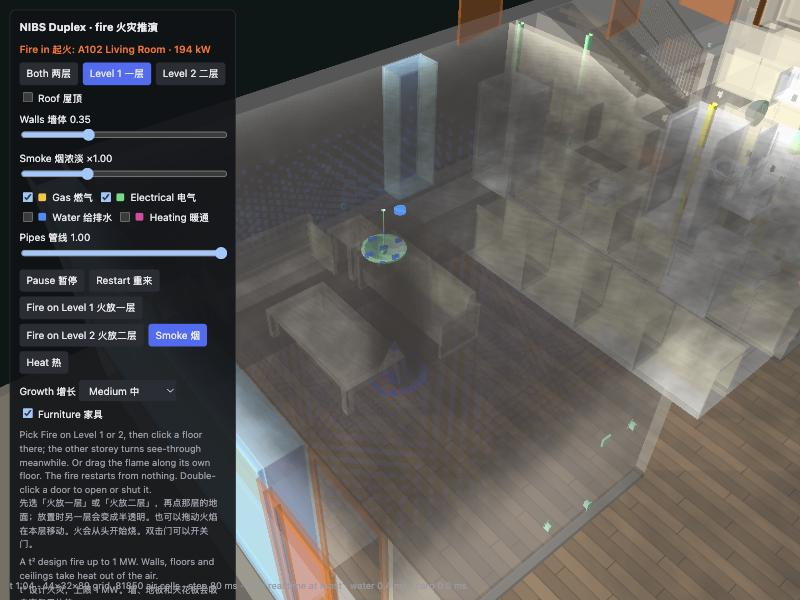

# E 水：第一版做完（2026-11-09）

## 做了什么

- **`duplex-fire/src/water.js`（新）**：水管网、破口、喷淋头、水滴下落、蒸发吸热、落在家具上的水。world 自动加载，没改 main.js。
- **`materials.json` 里水的几条**：`water_pipe`、`drain_pipe` 改成 IFC 写的材质；新加 `water_supply`（水网）、`water_spray`（喷出的水）、`sprinkler`（喷淋头）。每个数都有来源或标「假设 / [估]」。卡片会把它们列出来。
- **`duplex-fire/tools/water-check.mjs`（新）**：下面「检查了什么」里的数都是它跑出来的：`node tools/water-check.mjs 180`。

### 管网

- **材质（IFC 原文）：** 冷水、热水管是铜管（Plumbing 文件写 `Copper - A`，25 mm 管外径 25.4、内径 23 mm）。污水管是 `Plastic - Schedule 40`，雨水管是 PVC。排水管里没有压力，破了不喷水。
- **件数：** 给水 278 件（A 户冷水 71、热水 64；B 户冷水 73、热水 70），另有 4 个防回流阀接的是暖气，不算进来。
- **连法：** MEP 文件里没有「哪根接哪根」的记录（Plumbing 文件有，但它是一年后的修订版，约三分之一的管子挪过位置）。所以按包围盒判：相距 2 cm 以内算接上。这样判，每户的冷水、热水各自连成一整张网。
- **进水口和总阀：** 两户的冷水各从西墙外（x ≈ −0.4 m）、地面下约 0.46 m 的夹层进户：A 户是 e455，B 户是 e421。模型里没有水表和总阀，就各加一个在这里（位置是真的，阀本身是假设）。
- **热水从哪来：** 模型里没有接热水器。B 户的热水管碰得到冷水管，A 户的碰不到，就在离得最近的一处接上（e446 → e999，相距 3 cm，假设）。
- **水网是无限供应**（你定的），能做的只有开关总阀。

### 流量怎么算

- 从水网到每个出水口（破口或喷淋头）：水网压力 = 入户管和水表的损失 + 高差 + 屋里这一路管道的损失 + 出水口本身的损失。屋里这一路取「从进水口出发阻力最小的那条」。
- 同一户的几个出水口共用入户管和水表，所以多开一个，前一个就变小（实测见下）。水表以后的分支当作互不影响（假设）。
- 关掉总阀，这一户所有破口和喷淋头都停。

### 水管什么时候自己坏

- **只有接头会坏**：铜管本身 1085°C 才熔化，接头是焊上的。能坏的接头 115 个（其余埋在网格外，或者是直管）。
- 接头温度跟着周围空气慢慢升，到焊料开始熔化的 233°C（95/5 锡锑焊料的固相线）就开，开口取管截面的 1/4。
  - 跟得多快是**假设**：露在外面的 120 s，埋在墙里的（`wallAir`）600 s。
  - **已知的问题：** 管里一直有带压的水，水在约 150°C 才沸腾，真实的接头可能比这里撑得更久。现在没有模拟这一点。
- `cut(id)` 是你自己剪：整个截面都开。

### 喷淋头

- 用的是 Reliable F1Res49 下垂型住宅喷淋头（产品手册 Bulletin 135，2025 年 3 月版，原文读过）：68°C、快速响应、K = 4.9、在 7 psi 下 49 L/min、覆盖 3.7 × 3.7 m。
- 玻璃泡怎么被烤热，用 RTI 模型：`dTe/dt = sqrt(u) / RTI × (Tg − Te)`，u 是喷头处的气流速度，RTI 取 50（NFPA 13 对住宅喷淋头的上限，真实的喷头更快）。
- 加装：`addSprinkler(x, y, z)` 把喷头放到这个点上方天花板下的那一格，从最近的冷水管接一根 25 mm 支管。
- 喷出的水均匀撒在它覆盖的方块里（同一层格子，不穿墙），然后自己往下落。

### 水在空气里

- 水是一个场（每立方米空气里有多少 kg 水），用 `fire.addScalar('water')` 登记，随气流走，总量守恒。
- **下落：** 1 mm 的水滴以 4.03 m/s 下落（Gunn & Kinzer 1949，凭记忆，没重读原文）。每一步在气流搬运之外再往下移；下面是地板就落到地上，是家具顶面就落到家具上。所以热烟往上冲的地方，水会被托住、吹偏。
- **蒸发：** 只在超过 100°C 的空气里蒸发。快慢按对流给水滴的热（Ranz–Marshall 公式），每 kg 从那格空气里拿走 2.61 MJ（从 15°C 热到 100°C，再汽化）。不会把空气降到 100°C 以下。水没有单独的温度场：没蒸发就落地的水，算作没有降过温（假设，会少算一点冷却）。

### 写给 B（燃烧）的

- 每件家具上有两个数，由我写：
  - `o.wet`：落到它上面的水，累计 kg。
  - `o.wetRate`：此刻落到它顶面上的水，kg/m²/s，也就是 mm/s（按 1 s 平滑）。
- **建议 B 这样降热释放：** Evans 1993（NISTIR 5254）的公式：喷淋启动后，热释放按 exp(−t/τ) 衰减，τ = 3.0 × (`wetRate` 的 mm/s)^−1.85 秒。在 0.07 mm/s 时 τ ≈ 410 s。来源写在 `materials.json` 的 `water_spray.suppression`。
- **要提醒 B 的：** 这个公式来自木垛实验，衰减很慢。Madrzykowski & Vettori 1992（NISTIR 4833）试过一张乙烯面、聚氨酯泡沫的沙发：喷头一开，上表面的明火几秒内就灭了，只剩沙发底下的小火苗。软垫可能要另外处理，由 B 定。

### 控制台

都在 `duplexFire.water`（也是 `duplexFire.world.water`）下面：

| 函数 | 做什么 |
|---|---|
| `cut('e624')` | 剪断一根给水管，返回这一口每分钟喷多少升 |
| `valve('A', false)` | 关 A 户总阀；`valve('A')` 切换；`valve()` 看两户的状态 |
| `addSprinkler(x, y, z)` | 加装喷淋头，返回编号 `s1`；`removeSprinkler('s1')`、`clearSprinklers()` |
| `sprinklers` | 每个喷头：位置、房间、玻璃泡温度、开了没有、流量 |
| `status()` | 每户水表后的压力、总流量，每个出水口的流量 |
| `books()` | 水的去向：喷出、空气里、蒸发、地上、家具上 |
| `pipesNear(x, y, z)` | 离一个点最近的几根给水管（找剪哪根用） |
| `joints()` | 最热的几个接头的温度 |
| `show(true/false)` | 显示 / 隐藏水点 |
| `cost()` | 这个模块每步各阶段用多少毫秒 |
| `trigger('s1')` | 只给测试用：不等温度，直接让喷头动作 |

**给 F（鼠标工具）：** 剪刀调 `cut(id)`，阀门调 `valve(unit, open)`。物体表里给水管的 `class` 是「水管」；喷淋头加装后也进物体表，`class` 是「喷淋头」，编号 `s1`、`s2`……

**会发出的事件（给 G）：** `水管失效`、`水管剪断`、`喷淋头动作`、`关阀`、`开阀`。

## 你在页面上能看到什么

- 喷淋头是一个小圆片：没动作时红色，动作后变蓝。破口处有一个蓝色小球。
- 喷出的水是蓝色的点（最多 8000 个，每 3 步更新一次）。**被烟挡着时看不太清**：页面先画场景、再盖一层烟的体积渲染。想看水可以先把烟调淡。



**怎么试：**

```js
const d = duplexFire, r = d.meta.rooms.find(r => r.code === 'A102');
const x = (r.min[0] + r.max[0]) / 2, z = (r.min[2] + r.max[2]) / 2;
d.placeFire(x, z, 1);              // 先放火：放火会重置，之前的剪管会被清掉
d.water.addSprinkler(x, 2, z);     // 喷淋头会留着，不会被重置
```

**注意：** 放火（`placeFire`）会让整个世界重来，已经剪开的管子会恢复。所以要先放火、再剪管。加装的喷淋头和总阀的开关不会被重置。

## 检查了什么

都用 `node tools/water-check.mjs`：客厅 A102 中央、快速 t² 火（上限 1 MW），同一场火跑两遍，第二遍在火的正上方加一个喷淋头。

### 1. 有喷淋和没喷淋，火的走法不一样

- 喷淋头在 **54.9 s** 动作：这时火约 140 kW，喷头处的气体 148°C，每分钟喷 60 L。
- 天花板下 0.3 m 那层空气的平均温度（°C）和空气里的热（MJ）：

| t (s) | 没喷淋 | 有喷淋 |
|---|---|---|
| 60 | 47°C · 1.2 MJ | 47°C · 1.2 MJ |
| 120 | 154°C · 8.0 MJ | 149°C · 7.8 MJ |
| 150 | 228°C · 14.2 MJ | 216°C · 13.6 MJ |
| 180 | 257°C · 19.1 MJ | 238°C · 17.9 MJ |

- **差别现在不大，这是对的：** B 还没做，火的热释放是固定的设计火，不会因为被淋湿而变小。现在的差别全部来自水滴蒸发吸热：180 s 里蒸发了 1.0 kg 水，从空气里拿走 2.6 MJ。B 接上 `wetRate` 以后，差别主要会来自家具的热释放降下来。
- **落到家具上的水：** 180 s 里喷出 126 kg，落到家具上 25 kg：大茶几 13.3 kg，沙发 10.3 kg，小茶几 1.3 kg。沙发顶面此刻 0.068 mm/s，接近喷头覆盖范围的平均值 0.073 mm/s（60 L/min ÷ 13.7 m²）。
- 修过一个错：原来每件家具只用一格来接水，只接到应有的 3%，现在按它整个顶面接。

### 2. 蒸发吸的热和蒸发掉的水对得上

- 蒸发掉 1.0063 kg，记下的吸热 2.629 MJ，正好是 1.0063 × 2.613 MJ/kg。
- 直接量空气里的热：蒸发那一步前后，空气的热一共少了 2.629 MJ，和记下的差 −0.008 kJ（0.0003%，是 Float32 的舍入误差）。

### 3. 水一滴不少

喷出 125.84 kg = 还在空气里 0.58 + 蒸发 1.006 + 地上 99.34 + 家具上 24.92 kg，对不上的只有 约 0.000005 kg。（关门时有格子变成墙，那里的水会被清掉、不计入；这次没关门。）

### 4. 流量

- 剪断客厅附近一根冷水管（e624，A 户）：**60.5 L/min**。
- 同一户再剪一根：两口加起来 84.7 L/min（49.4 + 35.2），水表后的压力从 414 降到 209 kPa。
- 关 A 户总阀：两口都停，B 户不受影响。
- 喷淋头在水网压力下喷 60 L/min，比手册上 7 psi 时的最低值 49 L/min 多，因为水网压力高得多。

### 5. 每步耗时

- **water.js 每步约 0.15 ms**（主要是水滴下落和蒸发那一遍扫格子），只占 10 ms 预算的 1.5%。
- 还没有水的时候，这一遍直接跳过，几乎是 0。
- 页面里实测（状态行的 `world.timings()`）：water 0.2 ms，求解器 66–74 ms（页面里比 node 里慢）。

## 用的数，哪些是假设

| 数 | 用的值 | 来源 |
|---|---|---|
| 给水管材质 | 铜，25 mm（内径 23 mm） | IFC |
| 排水管材质 | PVC Sch 40 | IFC |
| 接头失效温度 | 233°C | Harris 95/5 焊料手册（固相线 452°F）；「到固相线就开」是假设 |
| 接头跟随时间 | 露在外面 120 s，墙里 600 s | **假设** |
| 失效接头的开口 | 截面的 1/4 | **假设** |
| 水网压力 | 414 kPa（60 psi） | **假设**，取供水公司常说的 40–80 psi 的中间 |
| 入户管 | 15 m 长 | **假设** |
| 水表损失 | 20 gpm 时 15 psi | [估] AWWA C700 的数，转述来的，没查原标准 |
| 管道摩擦系数、弯头损失 | 0.02、每个弯头或三通 1 | **假设**（手册范围内） |
| 孔口流量系数 | 0.62 | 教科书 |
| 喷淋头 | 68°C、K 4.9、覆盖 3.7 m | Reliable Bulletin 135 原文 |
| RTI | 50 | NFPA 13 的上限（转述，没读标准原文） |
| 水滴 | 1 mm、4.03 m/s | 直径是**假设**；速度来自 Gunn & Kinzer 1949（凭记忆） |
| 蒸发热 | 2.613 MJ/kg | [估] 15°C 进水，水的比热 + 汽化热（蒸汽表） |
| 蒸发快慢 | Ranz–Marshall | 1952 年的公式；空气物性用拟合式，在 600 K 和表对过 |
| 低于 100°C 不蒸发 | — | **假设** |

## 还差什么

- **B 读 `wetRate`**：现在火不会因为淋湿而变小。见上面「写给 B 的」。
- **接头失效**：跟随时间是猜的；管里有水能把接头压在约 150°C 这件事还没做。
- **水点的画法**：被烟挡住不好看。要么和烟的渲染合并（要动 `smoke-pass.js`，得先问），要么换个画法。
- **蒸汽稀释氧气**：没有氧气场，先不做。
- **地上的积水**：只记了总量，没画出来，也不会往低处流。
- **在夹层里的 40 根管子**在网格外：剪了也会流水，但看不到水去了哪。
- 喷淋头的覆盖范围现在是固定的方块；真实的水量分布中间多、外圈少。
