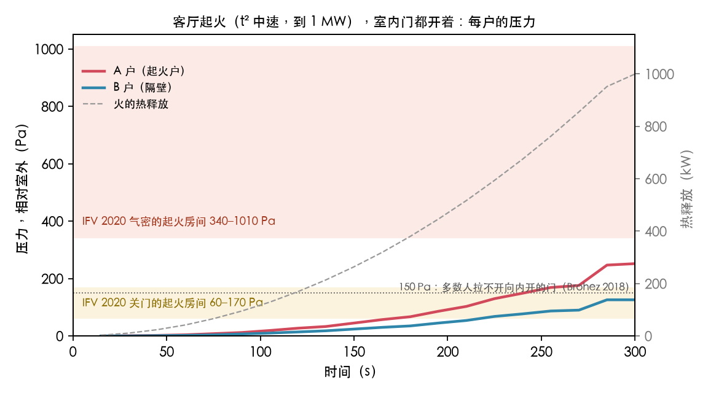
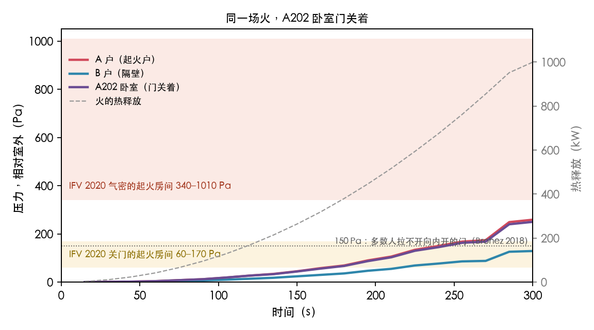

# F 动作与漏烟：第一版做完（2026-11-10）

## 做了什么

三个新文件，world 按名字自动加载，没改 `main.js`、`index.html`：

- **`src/actions.js`**：右下角的工具栏，三种鼠标工具，加一张开关表。
- **`src/sources.js`**：电网、燃气网、水网，每户一个电闸、一个燃气阀、一个水阀，加屋顶排风机的开关。
- **`src/leaks.js`**：每个封闭空气区一个压力；门缝、插座、穿墙孔、墙体、外墙按面积和压差搬烟和热。

另外：

- **`materials.json`** 新加两条 `leakage`、`exhaust_fan`，每个数带来源或标「假设」。
- **`tools/leaks-check.mjs`**（新）：下面「和实验对过什么」里的数都是它在 node 里跑出来的。用法：`node tools/leaks-check.mjs 300 A102 medium A202`（最后一个参数是要关上的门，可以不写）。

## 你在页面上能看到什么

**右下角「Tools 工具」：**

| 工具 | 指到什么会亮 | 点一下 |
|---|---|---|
| Scissors 剪刀 | 燃气管、给水管 | 剪断，调 D 的 `gas.cut` / E 的 `water.cut`。剪口处一个红圈 |
| Valves 阀门·电闸 | 两户的燃气阀（黄）、水阀（蓝）、配电箱 | 开 / 关。阀门把手绿色是开、红色是关 |
| Switch 设备开关 | 两台屋顶排风机 | 开 / 关 |

- 指到目标时，它本身发黄光，外面再套一个至少 30 cm 的框（3 cm 的弯头只发光的话，远看只有几个像素）。旁边有一行字说这是什么、点了会怎样。
- 隔着半透明的墙也能指到，和门的做法一样：只测当前工具能动的东西。不加体积渲染，只多一个发光网格和一个框。
- 选剪刀时，会自动打开「燃气」「给排水」图层，让你看得到管子。
- 手里拿着工具时，点击不会弹物体卡片，双击也不会开关门。再点一次按钮或按 Esc 放下工具。点「火放一层 / 二层」也会放下工具。
- 配电箱和排风机上方有一个小灯：绿色是通电 / 在转，红色是断电 / 关，灰色是开着但没电（电闸拉了）。
- 工具栏下面是开关表：每户的电、燃气阀、水阀、排风机，以及**这户此刻最高的压力（Pa）**。
- 重来（重放起火点）时，剪开的管子复原（D、E 自己清掉破口），**开关保持你设的样子**，和门一样。先布置好房子再点火，是这么用的。

**漏烟本身没有单独画**：它直接搬动烟、热、燃气和水的场，所以在烟和热成像里就能看到烟出现在隔壁户、出现在关着门的卧室里。

## 怎么做的

### 源（`sources.js`）

- 三种供应都当作无限供应（架构第 ④ 层）。每户只有一个开关在它和房子之间，只有你动它才会变。
- **电：** BIM 里每户一个配电箱（A101、B101 门厅），就当作电闸。它供电的东西里，对火有影响的只有同一配电箱上的屋顶排风机（IFC 的 `panel` 字段）。锅炉、水泵、灯也接在上面，但我们没有模拟它们做什么。
- **燃气阀、水阀归 D、E：** 他们各自管自己的管网、入户点和阀门。这里只列出来，并把你的开关转给他们（`gas.valve`、`water.valve`）。
- **状态写在物体表上**，leaks.js 从那里读，不直接调 sources.js：配电箱 `o.on`，排风机 `o.on` 和 `o.running`（开着并且有电）。

### 漏烟（`leaks.js`）

**为什么要自己算压力：** 求解器是不可压缩的，整栋房子在里面是封死的，热空气没法膨胀，所以关着的房间从来不会往外推。真实的住宅会。

**空气区：** 彼此连通的空气格子算一个区。只在门开关时重算，不每步算。
- 室内门都开着时，**每户就是一个区**（约 315 m³）。两户之间在网格里本来就不通。
- 关上一扇门，门后的房间就成了单独的一个区。
- BIM 里的壁橱没有门，所以每个壁橱是一个封死的小空腔（1–5 m³），名字带 closet。

**每个区涨多少：** 空气在定压下受热，每焦耳热多出的体积是 1/(ρ cp T)，和温度无关（CFAST 技术手册 NIST TN 1889v1 式 2.5，压力取稳态）。求解器记空气里的热是 ρ cp V × 高于环境的温度，所以
- 一个区的涨出速度 = 格子体积 × 这个区温度总和的变化率 / 293 K。
- 这个变化率**直接从温度场读**，在求解器、墙吸热和其他机制都做完之后、我搬东西之前读。所以它已经是火的热减去墙吸走的、水蒸发带走的。区在变冷时会收缩，把空气吸进来。
- 用 0.5 s 平滑一下，免得压力每步跳（假设）。

**每个孔漏多少：** ASHRAE / NIST CONTAM 的约定：有效漏风面积按 4 Pa、流量指数 0.65 给，
- q = 面积 × √(2·4/ρ) × (ΔP/4)^0.65。
- 每一步，找出让每个区的漏风（加上它的排风机）正好带走它涨出来的那部分的压力，室外是 0。准稳态：空气本身的弹性（CFAST 里的 dP/dt 项）没算，在这种漏风面积下它不到一秒就平衡（假设）。

**有哪些孔（都从网格和 IFC 找出来的）：**

| 种类 | 在哪 | 面积 | 来源 |
|---|---|---|---|
| 墙体 | 一堵墙两边的空气格子（墙厚 1–6 格） | 2 cm²/m² | CONTAM RESMISC（NISTIR 6585）内墙 |
| 分户墙 | 两户之间的墙 | 使它连同背对背插座占一户总漏风的 46%：合 1.36 cm²/m² | Bohac 等 2020：独立入户的住宅，54% 漏到室外 |
| 门缝 | 关着的室内门，门两边的格子 | 250 cm² | CONTAM RESMISC：关着的室内门，含门框和门底缝 |
| 插座 | 背对背的插座（同一堵墙两面、高度和位置对齐） | 2.5 cm² 一个，两个串联 = 1.8 cm² | ASHRAE 1997 第 25 章表 3：无密封垫的插座 |
| 穿墙孔 | IFC 里的给水、燃气、暖通管和电线管穿过墙或楼板 | 6 cm² | ASHRAE 同表：没封堵的管线穿墙 |
| 外墙 | 外墙和顶层天花板 | 一户总漏风减去分户的部分 | 一户总漏风按 3 次/h @ 50 Pa（IECC，Bohac 2020 引） |
| 排风机 | 风管下端（锅炉顶上，设备间里） | 991 L/s，直线风机曲线，250 Pa 时为 0 | IFC 型号名；风机曲线是假设 |

- **背对背插座找到 4 对，都在分户墙上：** A202 卧室  对  B203 卧室、A203  对  B202、两层的卫生间各一对。
- **穿墙孔找到 4 个**（两户之间或两个区之间的）。其余管子穿的是同一个区里的墙，或者是外墙（已算在外墙里）。
- **一户的漏风（node 里算的）：** 每户约 326 m³；总漏风 204 cm²；漏到隔壁户 94 cm²；漏到室外 110 cm²（54%）。如果分户墙也按 CONTAM 的 2 cm²/m²，漏到隔壁户会占 66%，和 Bohac 的实测不符，所以分户墙改按 Bohac 定。

**搬什么：** 一个孔把 q·dt 的空气从高压一侧搬到低压一侧，带走那边格子里同样比例的热、烟灰、未烧的燃料，以及用 `addScalar` 登记的燃气和水，放进另一侧配对的格子。所以总量守恒。从室外进来的空气什么也不带。漏到室外的记在 `books()` 里，所以账也对得上。

**事件（给 G）：**
- `漏烟`：烟第一次在另一户里看得见（那一格烟灰超过 0.01 g/m³，按 Mulholland 的 8.7 m²/g 约合能见度 35 m，阈值本身是假设），每条路线报一次，带时间和压差。
- `超压`：一个区的压力第一次超过 150 Pa（Brohez 2018：多数人拉不开向内开的门）。
- `拉闸` `合闸` `排风机开` `排风机关`。燃气阀、水阀的 `关阀` `开阀` 由 D、E 报。

### 控制台

`duplexFire.leaks`（也是 `duplexFire.world.leaks`）：

| 函数 | 做什么 |
|---|---|
| `zones()` | 每个有漏风的区：房间、体积、压力、涨出速度 |
| `summary()` | 各种孔：个数、总面积、此刻总流量 |
| `list('outlet')` | 每个孔：两边是哪个区、面积、流量 |
| `units()` | 每户的漏风：总的、到隔壁、到室外 |
| `books()` | 漏到室外的烟灰和热、两户之间搬了多少烟灰 |
| `firsts()` | 烟第一次在另一户里看得见的时间，按路线 |
| `peaks()` | 每个区最高的压力 |

`duplexFire.world.sources`：`breaker('A', false)`、`fan('A', true)`、`valve('gas', 'A', false)`、`status()`。

`duplexFire.world.actions.setTool('cut' | 'valve' | 'device' | null)`。

## 和实验对过什么

都是 `node tools/leaks-check.mjs 300 A102 medium [A202]` 跑出来的：客厅 A102 起火，现在的 t² 设计火（中速，300 s 到 1 MW），没有燃烧、辐射、燃气、水模块。

### 压力

| | 这里 | IFV 2020（荷兰消防学院） |
|---|---|---|
| 起火户最高压力 | 1 MW 时 250–283 Pa | 关着门的起火房间 60–170 Pa；气密的起火房间 340–1010 Pa |
| 什么时候过 150 Pa | 240 s，火约 680 kW | 摘要：开门前超过 300 Pa，再关门后超过 1000 Pa |
| 整户的漏风面积 | 每户 204 cm² | 测试的三户 54–227 cm²（鼓风门测试） |
| 隔壁户 | 被推到起火户的一半左右（143 Pa） | 没有给数 |

- **量级对得上：** 落在 IFV 两种情况之间，比 1973 年那栋老楼关门时高，比封死的气密房间低。
- **不能直接比的地方：**
  - IFV 烧的是真沙发，几分钟就到兆瓦级；这里是 5 分钟才到 1 MW 的设计火。
  - IFV 说的是一个房间的压力，这里是整户一个压力（门都开着时）。
  - 压力跟着「进入空气的热」走：1 MW 时每秒涨出约 0.54 m³，也就是只有约 190 kW 留在空气里，其余被辐射分数（35%）和墙吸走了。所以压力的高低也取决于 walls.js 吸热吸得对不对。
  - 进入空气的热每步有起伏，所以压力也会跳（图是每 15 s 取一个点，285 s 那一下就是这样）。

### 烟穿过插座

| 路线 | 烟第一次在 B 户看得见 | 当时两边压差 |
|---|---|---|
| 分户墙本身（均匀漏） | 111 s | 10 Pa |
| 卫生间背对背插座（二层 e680 对 e681） | 133 s | 16 Pa |
| 卫生间背对背插座（一层 e701 对 e703） | 156 s | 24 Pa |
| 卧室背对背插座（e677 对 e683、e689 对 e692） | 199–204 s | 43–44 Pa |

- **IFV：点火后 2.5–3 分钟（150–180 s），烟从分户墙的插座进了隔壁户。** 这里是 2–3.5 分钟，同一个量级。
- 「看得见」取那一格烟灰超过 0.01 g/m³，是假设。IFV 是人和摄像头看到的。火也不一样（见上）。

### 关着门的卧室

- A202 卧室门关着时，它的压力几乎和外面一样（275 Pa 对 285 Pa）：门缝 250 cm²，比卧室自己的漏风大得多，所以外面的压力几乎全传进来了。
- 300 s 里，门缝把 4.0 g 烟灰压进了卧室。

### 账

- **烟灰守恒：** 火放出 209.74 g = 空气里 198.04 g + 漏到室外 11.70 g，差 0.0000 g（两次运行都是）。
- 300 s 里，两户之间搬了 6.2 g 烟灰（约 3%），其中插座 0.2 g、穿墙孔 0.8 g，其余走分户墙本身。
- 漏到室外的热：1.15 MJ。

### 排风机和电闸（页面里试的）

- 打开 A 户排风机：A 户被抽到约 -153 Pa，风机实际流量 0.38 m³/s（直线风机曲线，压差越大流量越小）。
- 再拉 A 户的电闸：开关表显示「on, no power」，风机停，压力回到 0。

### 鼠标工具（页面里试的）

- 剪刀点到一根燃气弯头 e1031：D 的 `gas.cut` 收到，报「燃气管剪断」，每小时漏气 21.8 m³。
- 阀门工具点 A 户燃气阀：D 的阀门关上，报「关阀」。
- 我这边的浏览器面板是隐藏的，画面几乎不刷新，所以发光和框的截图没截到；用代码确认过选中和提示文字是对的，**还没在你的屏幕上看过**。

## 假设

- 一户的总漏风按美国现行规范 3 次/h @ 50 Pa。Duplex 是不是这么气密，不知道。
- 分户墙的漏风按 Bohac 2020 的平均比例（46%）定，不是按这堵墙本身的构造。
- 背对背插座两个串联取 A/√2。
- 同一个区里，漏风在高度上均匀分布：没有烟囱效应，所以烟不会偏向门缝的上沿出去、冷空气从下沿进来。
- 排风机：流量取 IFC 型号名的下限 991 L/s；风机曲线是直线，250 Pa 时流量为 0；默认关着；风管下端在锅炉顶上，假设锅炉在那里对房间敞开，所以从设备间抽气。
- 只算热膨胀。燃气泄漏本身加进来的体积没算（一根剪断的燃气管约 22 m³/h = 0.006 m³/s，同期火的热膨胀是 0.2–0.4 m³/s）。
- 压力是准稳态的，没算空气本身的弹性。
- 外墙漏风只用了三分之一的格子（均匀挑），总量不变，只是从更少、更大的孔出去（省计算）。
- 进入空气的热每步有起伏，压力也跟着跳，只平滑了 0.5 s。
- 1 MW 以上、压力很高时，真实的缝会被撑大（Janardhan 2017：到 1000 Pa 约 3 倍），窗框会坏（约 1400 Pa）。这里的孔大小不变。

## 每步耗时

| 在哪测的 | leaks 每步 | 其中 | 同时求解器每步 |
|---|---|---|---|
| node，30 s 快速火 | 1.1 ms | 求压力 0.12、搬东西 0.37，其余是每步把每个区的温度加一遍（约 0.6） | 约 110 ms（机器上同时跑着别的会话，平常约 43 ms） |
| 浏览器，面板隐藏 | 2.3 ms | 求压力 0.48、搬东西 0.52 | 158 ms |

- 按和求解器的比例换算，正常速度下 leaks 大约 0.5–1 ms，在 10 ms 的预算里。sources 和 actions 不进每一步（actions 的画面在自己的帧里更新）。
- 空气区只在门开关时重算：一次 12–74 ms（看机器忙不忙），开关门时卡一下。
- 为了省时间做过的：外墙漏风只用三分之一的格子；求压力从二分法改成牛顿法（0.63 ms 降到 0.12 ms，结果一样）。

## 还差

- **在你的屏幕上看一遍工具栏**：发光、框、小灯、开关表。
- 燃气泄漏加的体积（见假设）。
- 等 B（燃烧）接上后，用真沙发再跑一次，和 IFV 的沙发实验比时间。
- 同一区里的烟囱效应。
- 插座漏烟没有单独的画法，只靠烟场本身。如果要「烟从插座冒出来」看得更清楚，可以在插座处加一小簇点。
