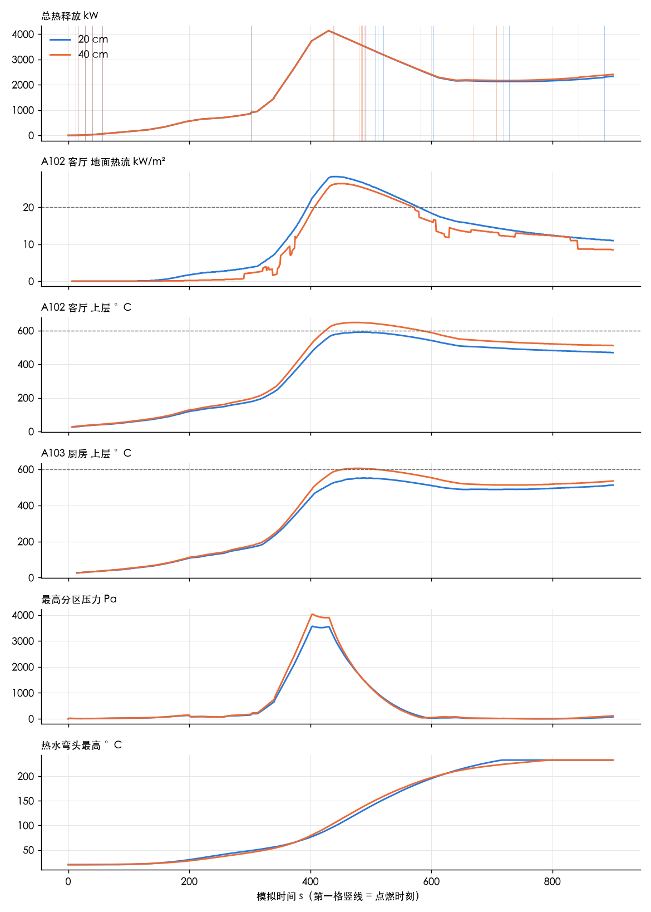

# 40 cm 格子：这场火还在不在（2026-11-11）

## 结论

**能换，但有一个前提：C 的轰燃规则不能再去点东西（只报事件）。** 不满足这个前提，40 cm 会弄坏厨房那一段。

- **能保住的：** 起火、蔓延的顺序，每件家具是怎么被点着的（火焰接触、辐射、热烟），木柜灭了又着，漏烟的路线，水管接头被烤开。这些在 40 cm 里都还在，时刻差 0–80 秒。
- **会坏的：** 40 cm 的房子空气少了 17%，烟层更热：客厅 648 °C（20 cm 是 591 °C），厨房也过了 600 °C。页面里 C 的轰燃规则开着，于是第 455 秒厨房被规则**一次点着 11 个柜子**，其中 4 个在两种 20 cm 跑法里从来没着过。厨房那段一件一件传下去、灭了又着的过程，被一条规则盖掉了。20 cm 时厨房最高约 550 °C，规则从没碰到厨房，开不开规则结果完全一样。
- **速度：** 求解器每步从约 70 ms 降到约 6 ms（node 里量的），快了 11–12 倍。页面每帧大约从 62 ms 降到 22 ms 左右（推算，见「快多少」）。

- **两种格子都没做到的：** 关着门的卧室**不干净**。把楼上两间卧室的门关上，20 cm 和 40 cm 一样，到第 900 秒卧室里的烟和客厅一样浓。原因是压力太高（3.3–3.9 kPa）。这是 F 的事，和格子无关，见「关着的卧室」。

所以真正要定的不是格子，而是 C 的轰燃规则。`耦合.md` 已经提过「轰燃规则改成只报事件、不点火」。40 cm 让这件事从「可能」变成「一定」。

另外有几处只是格子带来的假象，不影响火怎么走，但要知道（见「哪些是格子造成的」）。

**后来加的另一条路：格子不变，压力少扫几遍。** 求解器每一步把全屋扫 40 遍来平衡压力，这占了一步时间的一半以上。扫 10 遍，**20 cm 下这场火一模一样**：每个事件差不到 0.4 秒，烟差不到 0.3%。求解器每步从约 55 ms 降到约 26 ms。这只要改 `mac3d.js` 里的一个数，没有格子带来的假象，C 的规则也不用先改。见「压力少扫几遍」。

## 压力少扫几遍（2026-11-11 晚上加的）

> **已改（2026-11-11，Billy 同意）：** `src/mac3d.js` 的 `this.iterations` 从 40 改成 10，并加了注释。用 `coupling-run.mjs` 在 40 cm 上跑了一遍，结果和 `PRESSURE_ITER=10` 那遍完全一样。页面没开过（localhost 关着），没提交。想恢复原样，改回 40 就行。
>
> 读代码的判断（没跑过）：D、E、F 用到的压力都不是从这一步来的。漏烟的分区压力是 leaks.js 按热膨胀自己算的；爆燃压力是 gas.js 按燃气云体积估的；排风机由 leaks.js 直接搬运。扫 10 遍只影响风场追得上追不上，爆燃那一瞬可能晚几步跟上。

**为什么试这个：** 在 node 里分段计时，20 cm 时一步里各部分占的比例：

- 压力平衡（`mac3d.js` 的 `project()`，每步把全屋扫 `iterations = 40` 遍）占 58–64%；
- 搬运热、烟、燃料、燃气、水占 18%；
- 风的搬运和混合约 20%；
- 所有机制模块加起来约 1%。

所以删机制省不了什么，大头是这 40 遍。

**怎么试的：** `coupling-run.mjs` 加了 `PRESSURE_ITER=<n>`，只在这次跑里改遍数，`mac3d.js` 没动。同一场火（门全开、轰燃规则关），和原来扫 40 遍的结果比。

| | 20 cm，40 遍 | 20 cm，10 遍 | 40 cm，40 遍 | 40 cm，20 遍 | 40 cm，10 遍 |
|---|---|---|---|---|---|
| 每步（ms，单独计时，同一时间连着量） | 55 | **26** | 5.3 | 3.6 | **2.7** |
| 其中压力平衡 | 35 | 8.6 | 3.1 | 1.6 | 0.9 |
| 16 次点燃的时刻 | 基准 | 每次差 0–0.4 s | — | 和 40 遍相同 | 和 40 遍相同（最后一次差 1 s） |
| 漏烟、超压、水管失效 | 基准 | 每个差 0–0.3 s | — | 相同 | 相同 |
| 最高压力 | 3,564.6 Pa | 3,565.2 Pa | 4,030.4 | 4,030.4 | 4,030.4 |
| 烟到各房间的时刻 | 基准 | 只有 B205 早 1 秒 | — | 相同 | 相同 |
| 第 900 秒各房间的烟 | 基准 | 差不到 0.3% | — | 差不到 0.01% | 差不到 0.03% |

（20 cm 那一列的毫秒数是专门计时的结果。整场跑时 node 报的是 69 对 30 ms，那时电脑上还有别的会话在跑。比例一致：约一半。）

- **为什么 10 遍就够：** 每一步都从上一步的压力开始（warm start），并且是加速过的扫法（SOR）。火是慢慢变的，上一步的压力已经差不多对了，补几遍就行。`mac3d.js` 的注释说「扫得太少，烟到不了隔壁房间」，指的是不带这两样的普通扫法。
- **突然的变化也试了（20 cm，40 遍对 10 遍）：**
  - **关门的场景：** A202、A203 一开始就关门，跑 900 秒。19 次点燃每次差不到 0.4 秒，11 个其他事件差不到 0.1 秒，最高压力都是 3,532.9 Pa，各房间压力每秒最多差 8 Pa，第 900 秒各房间的烟差 −3% 到 +1%。
  - **中途开关门：** 门全开起火。第 300 秒关上 A202、A203（压力正在涨，约 140 Pa）；第 420 秒在压力最高的时候（约 3.2 kPa）重新打开 A202。跑 600 秒（`TOGGLE=A202@300,A203@300,A202@420`，脚本照 doors.js 的 `setCells` 开关门）。门动之后的那几秒最可能追不上，结果：
    - 关门后第 2、3 秒，卧室压力 97.6 对 97.5 Pa、131.6 对 130.3 Pa。
    - 第 420 秒开门，压力从 3.2 kPa 掉到 2.7 kPa 再回升，第 422 秒是 2,698.6 对 2,695.0 Pa。
    - 整段各分区压力每秒最多差 13 Pa（约 0.5%）。
    - 13 次点燃差不到 0.3 秒，事件差不到 0.1 秒，烟差 1% 以内。
  - 所以开关门这种突变，10 遍也跟得上。
- **还没试的：** 燃气爆燃（压力在几步里跳很多，比开门更猛）和别的起火点。爆燃要人去剪燃气管，这次没做。要换的话，最好请 D 用 `gas-check.mjs` 在扫 10 遍下跑一下爆燃。
- 这几遍跑的时候，B 又改了两次 combustion.js（`54ca01d`、`034ac93`），结果和旧版一样。电脑同时很忙，所以整场跑里 node 报的毫秒数不能用，速度看上面单独计时的那一行。
- 有一遍用的是 B 新改的 combustion.js（`54ca01d`），结果和旧版一样。

**页面上大概是什么样（推算，没在页面里量）：** 页面里 20 cm 的求解器约 45 ms，按比例扫 10 遍约 21 ms。一帧从约 62 ms 降到约 39 ms，约 26 帧每秒，模拟约 1.3 倍真实时间。40 cm 加上扫 10 遍，一帧约 19 ms。

**这样一来，可以选的路变成三条：**

| | 20 cm，扫 10 遍 | 40 cm（扫 40 遍） | 40 cm，扫 10 遍 |
|---|---|---|---|
| 页面一帧（推算） | 约 39 ms | 约 22 ms | 约 19 ms |
| 模拟速度 | 约 1.3 倍真实时间 | 约 2.2 倍 | 约 2.6 倍 |
| 火和 20 cm 一样吗 | 一样 | 厨房早 20–30 s，烟层更热 | 同左 |
| 格子假象（引火源 1 格、门宽、两户不对称、水） | 没有 | 有 | 有 |
| 前提 | 无 | C 的规则只报事件 | 同左 |
| 要改的 | `mac3d.js` 一个数（主引擎） | `house.js` 一个数 + C | 两个数 + C |

## 怎么比的

- 同一场火：50 kW、200 秒的引火源放在 A102 客厅沙发 e159 前面（[2.6, 14.6]），所有模块都加载，模拟 900 秒。和 `耦合.md` 是同一个设置。
- 脚本：`duplex-fire/tools/coupling-run.mjs`。这次加了三个选项（后来又加了 `PRESSURE_ITER`，见上一节）：
  - 第三个参数是格子大小，默认 0.2，默认输出不变；
  - `COUPLING_TAG` 指定输出文件名；
  - `CLOSE=A202,A203` 一开始就关上这些房间的门。
  
  另外每秒多记一项：每个房间的平均烟灰，以及离地 1.5 m 那一层的烟灰。
- 静态检查：`进度/耦合/grid-check.mjs`。不跑时间，只看格子对引火源、物体、门、房间、分区做了什么。结果在 `grid-check.json`。
- 对比：`进度/耦合/compare-40.py`，图是 `40cm-compare.png`。
- **combustion.js 的版本：** 所有对比跑用的都是工作区里 sha `0fb722f` 那版，里面已经有 B 的修复（火焰在天花板截断）。所以这次楼上的床 e165 和茶几 e182 都没着。B 在 16:30 又改过一次 combustion.js，我查了，改的是画火焰（`ceilingAbove` 只在 `drawFlames` 里用）。改动前后的 20 cm 跑，点燃记录一模一样。
- 用到的跑：

| 文件 | 格子 | 轰燃规则 | 门 | 用时 |
|---|---|---|---|---|
| `coupling-norule-20soot.json` | 20 cm | 关 | 全开 | 21 分钟 |
| `coupling-norule-40.json` | 40 cm | 关 | 全开 | 1 分 49 秒 |
| `coupling-rule-40.json` | 40 cm | 开（页面默认） | 全开 | 2 分钟 |
| `coupling-norule-20-shut.json` / `-40-shut.json` | 20 / 40 cm | 关 | A202、A203 关 | 15 分钟 / 1 分 29 秒 |
| `coupling-norule.json`（B 16:07 跑的） | 20 cm | 关 | 全开 | 22 分钟 |
| `coupling-rule.json`（耦合会话，修复前） | 20 cm | 开 | 全开 | — |

`coupling-norule-20-before-fix.json` 是修复前的旧基线，留着备查。

## 事件逐条对比

### 点燃（轰燃规则关）

| 物体 | 房间 | 20 cm | 40 cm | 怎么着的（20 cm / 40 cm） |
|---|---|---|---|---|
| e159 沙发 | A102 | 12.0 s | 12.0 s | 引火源火焰接触 / 同 |
| e162 大茶几 | A102 | 16.4 | 16.4 | 火焰接触 / 同 |
| e160 小茶几 | A102 | 28.3 | 28.3 | 火焰接触 / 同 |
| e158 另一张沙发 | A102 | 40.2 | 40.2 | 火焰接触 / 同 |
| e161 小茶几 | A102 | 56.6 | 56.6 | 火焰接触 / 同 |
| e162 熄灭 | A102 | 260 | 260 | 外来热流不够 / 同 |
| e162 重新点着 | A102 | 301.7 | 302.4 | 辐射 20.5 / 20.3 kW/m² |
| e152 地柜 | A103 | 439.0 | 437.7 | 辐射 41.3 / 42.5 |
| e151 地柜 | A103 | 490.7 | 485.4 | 火焰接触（C 辐射 29.7）/ 辐射 30.4 |
| e170、e169 吊柜 | A103 | 508.0 | 480.4、484.4 | 热烟 34.5 / 热烟 40 |
| e168 吊柜 | A103 | 511.6 | 488.5 | 热烟 34 / 38.6 |
| e167 吊柜 | A103 | 521.1 | 493.5 | 热烟 31.9 / 37.2 |
| e167 灭 → 着 → 灭 → 着 | A103 | 581 / 719 / 779 / 886 | 554 / 670 / 730 / 843 | 同样的循环，早约 40 s |
| e150 地柜 | A103 | 603.3 | 582.4 | 火焰接触 / 同 |
| e148 地柜 | A103 | 728.1 | 707.1 | 火焰接触 / 同 |

「怎么着的」和 `耦合.md` 的读法一样：看点燃前一秒 B 用的热流 qIn，是哪一项最大。正好等于 30 kW/m² 就是火焰接触；比 C 算的辐射大，就是热气接触；否则是辐射。

- **客厅那一段完全一样。** 前一分钟靠火焰接触，这只看物体的包围盒和 `flameReach`（0.2 m），和格子无关。
- **厨房那一段：同一批家具、同样的方式，早了 20–30 秒。** 吊柜被泡在更热的烟里（热气接触 37–40 kW/m²，20 cm 是 32–34），所以着得早。e151 从「火焰接触」变成「辐射」，因为 C 算的辐射刚好从 29.7 涨过了 30。这不是机制变了，是同一个热流读数擦过了 30 这条线。
- 楼上的床 e165、茶几 e182 两边都没着（B 的修复生效了）。

### 轰燃规则开着时（页面的默认）

| | 20 cm（`coupling-rule.json`） | 40 cm（`coupling-rule-40.json`） |
|---|---|---|
| 客厅触发 | 395.1 s，由地面热流 20.1 kW/m² 触发；能点的已经全在烧 | 406.6 s，同样由地面热流触发；同样没多点着什么 |
| 厨房触发 | **没有**，上层最高约 550 °C | **455.1 s，由上层 600 °C 触发：一次点着 11 个柜子**（e142、e143、e144、e145、e148、e150、e151、e167–e170） |
| 之后 | 和不开规则一样 | e142–e145 在两种 20 cm 跑法里从来没着过；e148、e150 提前了 2–4.5 分钟 |

**这是 40 cm 唯一真正弄坏的东西**：厨房的蔓延从「被辐射、被热烟一件一件点着」变成了「规则一次全点」。

### 轰燃判据（拿来当检查）

| | 20 cm | 40 cm |
|---|---|---|
| 客厅地面 20 kW/m² | 第 395 秒越过，最高 28.3 | 第 407 秒越过，最高 26.4 |
| 客厅上层 600 °C | 没到，最高 591 °C（第 485 秒） | **第 425 秒越过**，最高 648 °C（第 467 秒） |
| 厨房上层 600 °C | 没到，最高约 550 °C | **第 455 秒越过** |

40 cm 的地面热流曲线是锯齿状的（图第二格）：C 在每间房取 9 个点的柱子，40 cm 时一根柱子只有几格。前 300 秒地面热流也偏低（约 0.5 kW/m²，20 cm 是 2–4）。好在越过 20 的时刻只差 12 秒。

### 热释放

两条曲线几乎重合：都是第 430 秒达到峰值 4,132 kW，第 900 秒是 2.35 / 2.41 MW。原因是 B 按 NIST 曲线照放，烧多快只看点着的时刻，不看周围（`耦合.md` 回路 ① 的缺口）。**所以这一项一样，不代表 40 cm 没问题**：要是以后 B 让「受热越多、烧得越快」（`耦合.md` 里的甲、乙两条路），40 cm 更热的烟层会让火烧得更快，差别会被放大。

### 压力和漏烟

| | 20 cm | 40 cm |
|---|---|---|
| A 户最高压力 | 3,565 Pa（第 404 秒） | 4,030 Pa（第 403 秒），高 13% |
| B 户最高压力 | 1,349 Pa | 1,485 Pa |
| 分区个数 | 6 | 2 |
| 超压 150 Pa（A 户 / B 户 / A201 小气囊） | 302 / 323 / 383 s | 287 / 320 / 没有 |
| 漏烟：隔墙 | 138 s | 157 s |
| 漏烟：e701 与 e703 插座 | 139 | 165 |
| 漏烟：e680 与 e681 | 160 | 198 |
| 漏烟：e677 与 e683 | 188 | 241 |
| 漏烟：e689 与 e692 | 197 | 238 |
| 隔墙第二次漏烟 | 629 | 611 |

- **五条漏烟路线一条不少**，都晚了 19–53 秒，最后两条的先后换了一下。
- 少掉的 4 个分区，是 20 cm 里 1–2 m³ 的封闭小气囊（A201、B201 各一个，A205、B205 各一个连着屋顶）。40 cm 时这些缝被墙吃掉了。少掉的「A201 超压」事件也是它们中的一个。这不是火变了，是 20 cm 自己的小毛病，不用为它保留 20 cm。

### 烟往哪走（离地 1.5 m 处烟灰超过 0.01 g/m³ 的时刻）

| | A103 | A102 | A101 | A105 | A201 | A104 | A204 | A205 | A203 | A202 | B104 | B205 | B204 | B 户其余 |
|---|---|---|---|---|---|---|---|---|---|---|---|---|---|---|
| 20 cm | 55 | 60 | 90 | 91 | 102 | 115 | 130 | 146 | 159 | 163 | 197 | 237 | 251 | 311–388 |
| 40 cm | 55 | 56 | 90 | 91 | 103 | 108 | 124 | 143 | 150 | 159 | 186 | 222 | 239 | 288–345 |

- **烟到各房间的先后顺序一样**。A 户里的时刻相差不到 10 秒；隔壁 B 户早到 4–44 秒。
- 第 900 秒时，离地 1.5 m 处，40 cm 的烟都更浓：A 户浓 14–16%（3.5–4.2 g/m³，20 cm 是 3.0–3.6）；B 户浓 12–52%（0.36–1.06，20 cm 是 0.24–0.76）。A 户那部分大致就是「同样多的烟灰装进少 17% 的空气」；B 户差得更多，是因为漏过去的量也跟着压力变了。

### 关着的卧室

页面默认屋里的门全开，所以上面那几遍里，楼上两间卧室 A202、A203 和客厅是同一个分区。为了看「关着的门能不能挡住烟」，另跑了两遍：同一场火，A202、A203 的门一开始就关上（`CLOSE=A202,A203`）。

| 离地 1.5 m 的烟灰（g/m³） | 20 cm A202 / A203 | 40 cm A202 / A203 | 对照：客厅 A102，20 / 40 cm |
|---|---|---|---|
| 首次超过 0.01 | 212 s / 214 s | 189 s / 186 s | 60 / 56 s |
| 首次超过 0.1 | 346 / 345 | 320 / 319 | 147 / 133 |
| 第 300 秒 | 0.04 / 0.04 | 0.07 / 0.07 | 0.48 / 0.57 |
| 第 600 秒 | 1.29 / 1.49 | 1.77 / 1.89 | 2.02 / 2.18 |
| 第 900 秒 | **3.15 / 3.91** | **4.21 / 5.10** | 3.73 / 3.85 |
| 卧室最高压力 | 3,285 / 3,278 Pa | 3,898 / 3,877 Pa | 客厅分区 3,533 / 4,144 Pa |

- **两种格子都一样：关着门的卧室不干净。** 前 5 分钟烟进得慢；客厅压力冲到 3 kPa 以上之后，烟从门缝（leaks.js：关着的室内门 250 cm²）大量压进去。到第 900 秒，卧室的烟和客厅一样浓，甚至更浓：卧室几乎没有往外漏的地方，烟进去就出不来。
- 这不是 40 cm 的问题，**是压力的问题**：卧室被压到 3.3–3.9 kPa，只比着火的分区低约 250 Pa。`耦合.md` 已经说过 3.5 kPa 比 IFV 2020 的约 300 Pa 高一个数量级，要 F 核对。关门这件事把它变成了看得见的后果：真实火灾里，关门的卧室是最常见的「活下来的地方」（UL 的关门研究讲的就是这个；我没核对原文，标「待查」）。
- 40 cm 只是让同样的事早来 20–25 秒、浓 30%，和上面「空气少 17%」一致。
- 关门以后，20 cm 的客厅上层**也**过了 600 °C（第 432 秒，最高 636 °C）：热散不进卧室了。所以「过 600 °C」在 20 cm 里也只差一点点，40 cm 把它推过去了。厨房在 20 cm 关门时仍然没过 600 °C，40 cm 关门时第 442 秒过了。上面「厨房被规则一次点着」的结论不变。
- 关门时点燃的顺序两边也一样：客厅五件 → e162 重新点着 → e152 → 吊柜和 e151 → e150 → e148。20 cm 在 790–830 秒多点着了厨房的 e143、e142、e144，40 cm 到 897 秒只点着了 e142。差别在最后两分钟。

### 水

| | 20 cm | 40 cm |
|---|---|---|
| 热水弯头 e1041 烤开 | 第 716 秒 | 第 794 秒（晚 78 秒） |
| 落到水槽柜 e142 上的水（到第 900 秒） | 0.3 kg | 21 kg |
| 燃气阀最高 | 72.7 °C | 83.2 °C（失效要 440 °C，两边都远远不到） |

- 弯头只有 3 cm 大，读的是它所在的那一格。40 cm 时那一格从 0.6 m 一直到 1.0 m，读到的是另一个高度的气温，所以前面热得快，后面热得慢，最后晚了 78 秒。
- **21 kg 是格子造成的假象：** 弯头在离地 0.6 m，水槽柜顶面在 0.86 m。40 cm 时两者落在同一格（0.6–1.0 m），water.js 把「从柜顶那一格往下落的水」都算作落到柜子上，于是喷出来的水几乎全记在柜子上。20 cm 时柜顶那一格在弯头上面，水直接落到地上。这一项对火没有影响（e142 两边都没烧），但如果以后有人拿「水浇在家具上」做卡片，40 cm 的数是错的。

## 哪些是格子造成的（不是火变了）

`grid-check.json` 的数：

| | 20 cm | 40 cm |
|---|---|---|
| 网格 | 44×32×89 | 22×16×44 |
| 空气格 | 81,850（654.8 m³） | 8,513（544.8 m³，**少 17%**） |
| A 户主分区体积 | 314.6 m³ | 276 m³ |
| 引火源 | 9 格，0.36 m²，格心离地 0.1 m | **1 格，0.16 m²，格心离地 0.4 m** |
| 室内门的通道宽（门高 1 m 处的空气列） | 都是 1.0 m（A205、B205 是 0.8 m） | 0.4–1.2 m 不等：A205 只有 0.4 m，A204 0.8 m 而 B204 1.2 m |
| 一楼地面 | 第一层空气格从 0.0 m 开始 | 从 0.2 m 开始 |
| 家具的 `cells` | 沙发 200–250，柜子 50–150 | 沙发 20–30，柜子 4–24；B103 厨房两个柜子只剩 4、6 格 |
| `wallAir`（埋在墙里的） | 429 件 | 412 件；115 件改变了归属：41 段水管、22 段排水管不再算埋在墙里，25 件设备、8 扇窗变成埋在墙里 |
| 一格空气都没有的物体（多是排水管、水管） | 107 | 102 |

另外：

- **A、B 两户在 40 cm 时不再对称。** 20 cm 时两户（镜像）的每个房间格数完全相同。40 cm 时：B103 厨房比 A103 少 17%，B205 比 A205 少 36%；B103 吊柜头上的「天花板」读成 2.2 m（A103 是 2.6 m）。所以 **40 cm 下，同一场火放在 B 户，不会和放在 A 户一样**。这次只跑了 A 户，B 户那边的蔓延没验证过。
- **引火源只剩 1 格。** 这次沙发照样第 12 秒被点着，因为点着靠的是火焰接触，看的是引火源的包围盒，不是格子。但是 1 格意味着拖动起火点时，火会一跳 40 cm，引火源的热也全堆在一格里。
- **轰燃判据的「上层」**：取房间顶上 1/3（radiation.js `upperLayer`，假设）。20 cm 时是 4 层格心（1.9–2.5 m），40 cm 时是 2 层（2.0、2.4 m），高度覆盖差不多。所以 648 °C 不是取样造成的，是房子本身变了：空气少 17%，同样的热升温更多。还有哪些别的原因（墙吸热按格子面算、数值扩散），我没有拆开查，是推测。

## 快多少

| 每步（ms） | 20 cm | 40 cm |
|---|---|---|
| 求解器 | 69.3 | 5.7 |
| 漏烟 | 0.50 | 0.06 |
| 辐射 | 0.39 | 0.19 |
| 燃烧 | 0.07 | 0.02 |
| 水 | 0.06 | 0.03 |
| 燃气 | 0.005 | 0.002 |
| 跑完 900 秒 | 21 分钟 | 1 分 49 秒 |

（node 里量的，同一时间电脑上还有别的会话在用。第一遍 40 cm 是 7.3 ms 对 71.8 ms，比例一样：约 1/10–1/12。）

页面里（`耦合.md` 量的）20 cm：求解器约 45 ms + 机制不到 1 ms + 画场景约 9 ms + 烟的体积渲染约 8.5 ms，一帧约 62 ms，约 16 帧每秒。按 1/10–1/12 推算，**40 cm 时求解器约 4 ms，一帧约 22 ms，约 45 帧每秒**（推算，没在页面里量：你说过不开 localhost）。

页面每帧走一步（0.05 秒），所以：

- 20 cm 时，模拟比真实时间慢（约 0.8 倍）。
- 40 cm 时，45 帧每秒就是约 2.2 倍真实时间：沙发 6.5 分钟到峰值，你约 3 分钟就能看到。

烟的体积渲染按 `grid.cell × 0.5` 步进，40 cm 时步子大一倍，大概也会更快，但会更粗（见下）。

**页面上没看的：** 40 cm 的烟看起来是什么样。体积纹理从 44×32×89 降到 22×16×44，靠近看会更糊，墙边、门边可能出现台阶。这是你的眼睛要判断的，我没开页面。

## 要换的话，改哪里、归谁

| 文件 | 改什么 | 归谁 |
|---|---|---|
| `src/house.js` | `export const CELL = 0.2` 改成 0.4。main.js 用的就是它。 | 主引擎（buildGrid 这一块） |
| `src/main.js` | 不用改代码：它用 `buildGrid(building, CELL)`。可以考虑每帧走两步，让速度回到 1 倍左右，把多出来的时间留给画面。 | 主引擎 |
| `src/radiation.js` | **轰燃规则改成只报事件、不点火**（或者门槛按格子改）。这是换 40 cm 的前提。 | C |
| `src/house.js` 的 `poolAt` 和 HouseFire 引火源 | 引火源只剩 1 格。要不要让它至少占 2×2 格，或者照旧（这次照样点着了沙发）。 | B |
| `src/water.js` | 落到家具上的水：出水口和家具顶面在同一格时，不该全算到家具上。只影响「浇湿」这个数。 | E |
| `src/smoke-pass.js` | 注释里写着「20 cm a cell」；`uStep`、`VEL_RANGE_CELLS` 都按 `grid.cell` 算，不用改代码。烟好不好看要你看。 | 主引擎 |
| `src/doors.js`、`house.js` 的门 | 门的格子按 `cell × 2` 加厚，40 cm 时关上的门是 0.8 m 厚的一块；通道宽 0.4–1.2 m 不等。 | 主引擎 |
| `src/leaks.js`、`objects.js`、`combustion.js`、`gas.js` | 都按 `grid.cell` 算，不用改。 | F、T0、B、D |
| `tools/` 里的检查脚本 | `combustion-check`、`radiation-check`、`gas-check`、`leaks-check`、`water-check` 都写死了 `buildGrid(building, 0.2)`，`objects-check` 用默认的 CELL。想在 40 cm 下复核，各自加一个参数。 | B、C、D、F、E、T0 |

## 如果你不想换（后台线程）

40 cm 没有失败（只要 C 的规则改掉），所以这里只简单说一下，没做：

- **思路：** 把 `world.step()`（求解器 + 所有模块的 act、source、transfer、react）放进 Web Worker，主线程只画画面。每画一帧，从 worker 拿一份场（温度、烟灰，大约 14 万格 × 2 个数，约 1 MB），以及物体表里会变的那几项（state、hrr、flux、wet）。
- **难的地方：**
  - 每个模块现在**同一个文件里既算又画**（combustion.js 有 `drawFlames`，radiation.js 有按热流上色，water、gas、actions 都画东西），而且直接写求解器的数组。搬进 worker，每个模块都要拆成「算的一半」和「画的一半」，六个负责人都要动。
  - 用户动作（开关门、剪管、关阀）要改成发消息。
  - 事件要从 worker 发回来。
  - 要用 SharedArrayBuffer 免复制的话，开发服务器还要加 COOP/COEP 头。
- **得到什么：** 页面不再卡（转视角、点按钮不用等求解器），但 20 cm 的模拟仍然只有约 0.7–0.8 倍真实时间，不会更快。
- 我的估计是一到两天，牵动所有模块。和改一个常数加一条规则比，代价大得多。

## 假设和没做的

- 只跑了一个起火点（A 户客厅沙发）。40 cm 下 B 户不对称，B 户起火没跑。
- 「怎么着的」是从每秒的记录反推的，不是 B 自己记的。
- 页面上的样子（烟、火焰、门）一眼都没看，因为不开 localhost。
- 页面的帧率是按 node 里的比例推算的。
- 跑的时候电脑上还有别的会话，毫秒数会偏大，但两种格子之间的比例不受影响。
