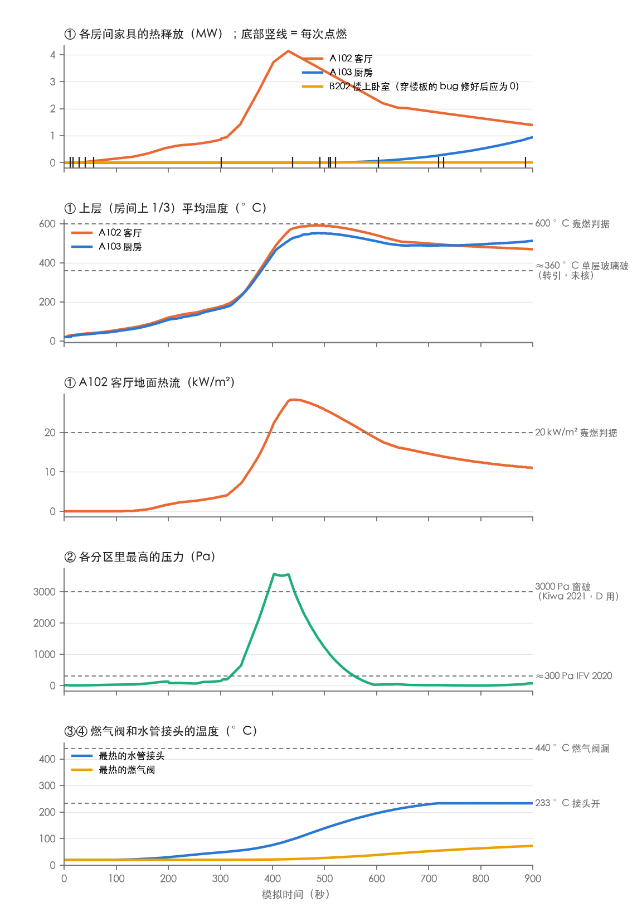

# 耦合：一场火，所有模块一起跑（2026-11-11）

## 一句话

把六块代码放进同一场火里跑了 15 分钟（模拟时间）。**轰燃回路自己转起来了**：沙发点着以后，火一件一件传到另一张沙发、三张茶几，再传到厨房的柜子。不靠 C 的轰燃规则，客厅在第 395 秒越过了「地面 20 kW/m²」。水管接头也被烤开了。断的地方有四处，各自写在下面的回路表里：

- 着火的家具不会因为被烤得更热而烧得更旺。
- 火焰穿过楼板，点着了楼上卧室的床（bug，B 已修好，还没提交，见「需要别人改的」）。
- 压力到了 3.5 kPa，但没有任何东西读它。
- 燃气回路这场火碰不到。

另外，你在页面上看不到火，主要是三个原因：

- 默认场景几乎没有火。
- 烟把火盖住了。
- 标题栏显示的功率不对。

## 怎么跑的

- 脚本：`duplex-fire/tools/coupling-run.mjs`。在 node 里建出整个 world，`world.load()` 加载所有模块（sources、combustion、gas、water、radiation、leaks；actions 和 card 在 node 里不画东西，自动跳过）。**每件家具都保持自己的可燃设定**。B 测沙发时，把其他家具都设成了不可燃，这次没有。
- 起火：50 kW、200 秒的引火源放在 A102 客厅沙发 e159 前面，坐标 [2.6, 14.6]，和 `combustion-check.mjs sofa` 用的同一个点。
- 跑两遍，每遍模拟 900 秒：
  - **规则**（`rule`）：C 的轰燃规则照常起作用（上层 600 °C 或地面 20 kW/m² 时，把房间里所有可燃物点着）。
  - **无规则**（`norule`）：只在脚本里把这两个门槛设成无穷大，radiation.js 没改。到没到 600 °C、20 kW/m² 照样记录，但不会因此点着任何东西。
- 每秒记一行：每件家具的状态、热释放、受到的热流（C 算的辐射，火焰和烟层分开记）、B 实际用的热流、累积受热；每个房间的上层温度和地面热流；每个分区的压力；燃气阀和水管接头的温度；喷水和落到家具上的水。结果在本文件夹的 `coupling-norule.json`、`coupling-rule.json`，图由 `tools/coupling-plot.py` 画。
- 用的是工作区里的 combustion.js：B 没提交的那版。和已提交的版本相比，它**只多了画火焰和「从哪里开始烧」的位置**，点燃、燃烧、熄灭的规则一行没改，所以两版跑出来一样。

## 两遍一样

**加不加 C 的轰燃规则，结果完全一样**：同样的 18 次点燃，同样的时刻。规则在第 395 秒触发了（由「地面热流 20.1 kW/m²」触发，那时上层只有 445 °C），可客厅里能点的 5 件家具那时早就全在烧了。第 6 件是木门，没有燃烧数据，`world.ignite` 对它返回 false。

所以在这场火里，**轰燃是回路自己长出来的，规则只是事后报了一下**。不过换一个起火点就不一定了：如果火从一件孤立的家具开始烧，规则可能抢在回路前面，把整间房一下全点着。

## 回路表



| 回路 | 转没转 | 停在哪里 |
|---|---|---|
| ① 轰燃：烧 → 烤别的 → 再点着 | **转了一大半** | 着火的家具按 NIST 曲线照放，**受到的热流不改变它烧得多快**：combustion.js 的 `it.model.hrr(it.t)` 只看时间，不读 `it.qIn`。另外，**火焰范围没有在天花板截断**（combustion.js 的 `addFlame`），火焰穿过楼板点着了楼上的床。 |
| ② 压力：热 → 压力 → 推烟、推热 | **转了，单向** | 压力最高到 3,565 Pa（第 404 秒），比 IFV 2020 的约 300 Pa 高一个数量级。**没人读这个压力**：「窗在 3000 Pa 破」这个数只在 gas.js 的爆燃里用，leaks.js 的分区压力不进去。 |
| ③ 燃气：泄漏 → 积在顶上 → 点着 → 阀失效 → 更多气 | **这场火里没转** | 燃气阀最高 72.8 °C，失效要 440 °C。没人剪管，就没有燃气。D 的回路要靠用户动作来开头，这符合「交互是用户动作」的定位，不算断。 |
| ④ 水：热 → 接头开 → 喷水 → 蒸发降温 / 浇湿家具 | **前半段转了** | 第 716 秒，厨房水槽底下的热水弯头 e1041 到 233 °C 开了。水喷在它所在的地柜 e142 上（到第 900 秒共 0.3 kg），但 **e142 没在烧**，所以水没有碰到火。就算碰到了，0.003 mm/s 的水量按 Evans 1993 的公式，τ = 3.0 × 0.0027^−1.85 ≈ 17 万秒，热释放降一半要一天多 [算]，等于没有。 |
| ⑤ 氧气 | **没有**（不归我开工，要你定） | 客厅火烧到 4.1 MW，没有任何东西限制它。 |
| ⑥ 门烧穿、窗破 | **没人负责** | 客厅上层在第 375 秒到 360 °C。另一个会话（local_c418…）查到「单层 3 mm 玻璃约 360±50 °C 破」，我没核对原文。压力在第 392 秒过 3000 Pa（Kiwa 2021，D 用的窗破压力）。两条都说窗该破了，但现在什么都不会破。 |

### ① 轰燃回路：每次点燃是怎么来的

B 用的热流取三者里最大的：C 算的辐射、火焰接触（固定 30 kW/m²）、碰到它的热气。下表「谁点着的」看的是哪一项最大。

| 时间 | 物体 | 房间 | 谁点着的 |
|---|---|---|---|
| 12 s | e159 沙发 | A102 | 引火源的火焰接触 |
| 16 s | e162 大茶几 | A102 | 火焰接触（沙发、引火源） |
| 28 s | e160 小茶几 | A102 | 火焰接触 |
| 40 s | e158 另一张沙发 | A102 | 火焰接触（两张沙发是 L 形紧挨着的） |
| 57 s | e161 小茶几 | A102 | 火焰接触 |
| 260 s | e162 大茶几**熄灭** | A102 | 外来热流不够，木头灭了（B 的规则） |
| 302 s | e162 **重新点着** | A102 | **辐射** 20.4 kW/m²（沙发长大了） |
| 412 s | e165 King 床 | **B202 楼上卧室** | **火焰接触：bug**。e158 沙发的火焰高度按 Heskestad 约 3.5 m，没在天花板截断，穿过楼板碰到了楼上的床。C 算的热流是 0。 |
| 428 s | e182 小茶几 | **B202 楼上卧室** | 同上 |
| 439 s | e152 厨房地柜 | A103 | **辐射** 41 kW/m²（火焰 35 + 烟层 6），离沙发约 1.1 m |
| 491 s | e151 地柜 | A103 | 辐射约 30 |
| 508–521 s | e167–e170 吊柜（离地 1.4–2.0 m） | A103 | **热烟层**：泡在 500 °C 的烟里，热气接触 32–34 kW/m²，C 算的辐射只有 12–13 |
| 581 / 719 / 779 / 885 s | e167 吊柜 灭 → 再着 → 灭 → 再着 | A103 | 木头离开足够的外来热就灭，热回来又着 |
| 603 / 728 s | e150、e148 地柜 | A103 | 热气接触 |

我看到的：

- **这就是涌现的样子。** 火按距离一件一件传：先传给挨着的，再靠辐射跨过约 1 m，最后到烟层里的高柜；木件还会灭了再着。没有一条规则说「第 X 秒厨房着」。
- **前 1 分钟的蔓延全靠火焰接触**：固定 30 kW/m²，加上火焰向四周伸 0.2 m 的范围。C 的辐射在这段只有 0.1–7 kW/m²，作用不大。客厅家具挨得近，这在物理上说得通，但这段蔓延的快慢基本由「伸 0.2 m」这一个**假设**决定。
- **到楼上卧室的蔓延是假的**，必须修，不然它会被当成一个「涌现事件」展示出来。
- **烧的速度没有跟着环境变**：e159 在第 402 秒到峰值 2.07 MW，从点燃算是 6.5 分钟，和它在实验室里单独烧（NIST TN 2303：6.3–6.6 分钟）一模一样，尽管这时它头上是 590 °C 的烟、地面热流 26 kW/m²。真实房间里，外来热流会让燃烧变快（Tewarson、Babrauskas 都讲过），这正是轰燃「突然加速」的那一半，现在缺着。

### 轰燃判据：拿来当检查

| 判据 | 客厅 | 厨房 |
|---|---|---|
| 地面 20 kW/m² | **第 395 秒越过**，最高 28.3 | 没到，最高约 14 |
| 上层 600 °C | **从来没到**，最高 591 °C（第 485 秒） | 没到，最高约 550 °C |

- 原先预想的是「上层 600 °C」会先触发（进度/C）。实际是地面热流先到，而且大部分来自两张沙发的火焰本身，不是烟层。
- 上层到不了 600 °C，可能的原因（**还没验证，都是推测**）：客厅、厨房、门厅连成一大片，门都开着，热散开了；墙在吸热；热的天花板和墙不往外辐射（C 自己写过这条缺口）。
- **还没和 Babrauskas 1981 对**：他测的是单件家具，最大的约 0.8 MW，这里是两张沙发一起 4 MW，不能直接比距离。要对，得单独设一个「一件 2 MW 在烧，看多远的东西会着」的场景。

## 你在页面上看到的问题

2026-11-11 在 http://localhost:5196/duplex-fire/ 里看的，只观察，没改任何文件。

1. **默认场景几乎没有火。** 默认火点在客厅正中，正好在大茶几底下。第 16 秒茶几着，最多 24 kW；引火源第 200 秒熄灭，茶几第 260 秒也灭了。沙发一直只受到 3 kW/m²，没着。默认打开页面，最多就是 50 kW 的燃烧器加一张小火的茶几。
2. **火被烟盖住。** 火点挪到沙发前面、推进到第 240 秒（约 600 kW）时，整个客厅被灰褐色的烟盖满，看不见火。把烟浓淡调到 ×0.1，火也只是沙发上一层淡淡的橙色。B 的火焰片从上往下看几乎没有存在感。
3. **标题栏的功率是错的。**「Fire in A102 · 0 kW」只显示引火源的功率，屋里在烧 600 kW 时它也是 0。
4. 沙发在客厅右下角，被「Tools 工具」面板挡住了一部分。
5. 左下的说明还写着「A t² design fire up to 1 MW」，「Growth 增长」菜单已经不起作用（B 进度里也提过）。
6. 燃气、电气管线默认是打开的；燃气总管画成一个大罐子，在西墙外。

## 为什么卡

在页面里量的，画布 1536×1152，求解器 20 cm 格子：

| 每帧 | 毫秒 |
|---|---|
| 求解器走一步 | 约 45 |
| 所有机制加起来 | 不到 1（漏烟 0.4，辐射 0.1，燃烧 0.07，水 0.02，燃气 0.01） |
| 画场景（115 次绘制，15 万个三角形） | 约 9 |
| 烟的体积渲染 | 约 8.5 |

- main.js 每画一帧，就同步走一步求解器，所以一帧至少 55 ms，最多约 18 帧每秒，浏览器主线程一直是满的。转视角、点按钮都要等求解器走完这一步。
- 窗口越大，渲染越慢（像素比上限 1.5）。
- node 里的整合跑，求解器每步 57–65 ms（量的时候还开着页面）。
- 10 ms 的机制预算守住了：全部机制每步约 0.9 ms。

## 需要别人改的（待你决定；除了下面这条 bug，都还没转达）

**修 bug（你同意后转给了 B，已修好，还没提交）：**

- **B（combustion.js）：火焰范围在天花板截断。** B 加了 `ceilingOver()`：从物体中心往上找第一个实心格，火焰接触的范围最高到这里，A102 是 2.6 m。没加天花板下的火焰铺开，也没碰烧的速度。B 把这个改动存成了单独的补丁，和还没决定的火焰画法分开，可以单独提交。
- **重跑结果（我核对过 `coupling-norule.json`）：** e165、e182 不再着。客厅和厨房的点燃时刻都没变，412 秒以后有几次挪了 0.1–0.2 秒，因为楼上那张床不再往同一片气流里加热和烟。峰值 4.13 MW、地面 395 秒越过 20 kW/m²、上层最高 591 °C、压力 3,565 Pa、接头 716 秒开，都和修之前一样。修之前的数据留在 `coupling-norule-20-before-fix.json`。本文前面的表格写的是修之前的结果，楼上那两行现在已经不发生了。

**要你定方向的：**

- **B：烧的速度要不要跟着受热变？** 两条路：
  - **甲**：NIST 曲线当作「空地上自由燃烧」的基准，再加上「外来热流 × 正在烧的面积 ÷ 汽化热 × 燃烧热」。单烧一张沙发时仍然和 NIST 对得上。
  - **乙**：不回放曲线，按「火焰自己的热流 + 外来热流」算出放热，再检查单烧沙发长出来的曲线离 NIST 多远。
- **C：轰燃规则改成只报事件、不点火？** 这场火里规则没起作用；换个起火点它可能会盖住回路。
- **F：3.5 kPa 对不对？** 高于 IFV 2020 一个数量级。这不一定是错的（火长到 4 MW 的速度比 IFV 的实验快），但要 F 核对。
- **谁来读压力？** 窗、门在多大压差下破，现在只有 D 的爆燃会用。
- **⑥ 门烧穿、窗破：没有负责人。** 它决定氧气从哪进来、烟从哪出去，也就决定了 ⑤。
- **主引擎（main.js 等）**，按你看画面时的需要：
  - 默认火点；
  - 标题栏改成显示屋里总的热释放；
  - 火被烟盖住怎么办；
  - 求解器挪到后台线程、默认暂停、或改 40 cm 格子。

**更正（写给 E 和主会话）：**

- 「客厅火只把接头烤到 31.5 °C，水回路自己不会触发」只在小火时成立。整屋烧起来以后，厨房水槽下的热水弯头在第 716 秒开了。
- 主会话说回路①「断在 B 的点燃没接上」，这不对：B 读 C 的 `flux` 是接上的，e162 重新点着、e152 被点着，都是辐射点着的。断的是「烧得多快」那一半，以及火焰穿楼板这个 bug。

## 怎么验证

你自己在页面上照着做：

1. 打开 http://localhost:5196/duplex-fire/ ，点「Level 1 一层」。
2. 打开浏览器控制台，把火放到沙发前面：`duplexFire.placeFire(2.6, 14.6, 1)`。也可以手动拖动火点，放到客厅右下角那张 L 形沙发的前沿。
3. 页面是实时跑的，要看几分钟后的样子，可以贴这段快进到第 T 秒（会卡一阵，正常）：

   ```js
   window.goto = async (T) => { const w = duplexFire.world; while (w.time < T) { for (let i = 0; i < 100 && w.time < T; i++) w.step(); await new Promise(r => setTimeout(r, 0)); } return w.time; };
   await goto(420);
   ```

4. 每到一个时刻，看这几行：

   | 看什么 | 控制台 | 应该看到（本文跑的结果） |
   |---|---|---|
   | 谁在烧 | `duplexFire.world.combustion.status()` | 60 s：两张沙发和三张茶几在烧；420 s：修之前会加上楼上的床（bug），修好后没有；520 s：厨房吊柜也着了 |
   | 轰燃判据 | `duplexFire.world.radiation.status().filter(r => r.room.startsWith('A10'))` | 客厅地面热流约 400 s 过 20；上层最高约 590 °C |
   | 压力 | `duplexFire.leaks.zones()` | 约 400 s 时有一个分区到 3000 Pa 以上 |
   | 水管接头 | `duplexFire.world.water.joints(3)` | 约 716 s 时 e1041 到 233 °C，`broken: true` |
   | 燃气阀 | `duplexFire.gas.parts()` | 一直在 100 °C 以下 |
   | 那个 bug | `duplexFire.world.objects.byId.get('e165').state` | 修之前约 412 s 变成「燃烧」；B 修好后一直不着 |

5. **眼睛看**：
   - 把「Smoke 烟浓淡」拉到最左，打开「Flux 热流」开关。家具会按受到的热流从蓝变黄、橙、红，正在烧的变白。这是现在唯一能看出回路①在转的画面。
   - 第 3 步里的数字和画面可能对不上，比如页面上看不出楼上的床在烧。这一点本身就是「看不见」的问题。
6. 你自己的电脑上也可以重跑整合跑（每遍约 18–20 分钟）：

   ```bash
   cd "duplex-fire" && node tools/coupling-run.mjs norule 900 && python3 tools/coupling-plot.py norule
   ```

   跑完后，图和 json 会更新在本文件夹里。

## 假设和没做的

- 只跑了一个起火点（客厅沙发），门都是开着的（页面默认）。关门、别的房间起火都没跑。
- 「谁点着的」是从每秒的记录里反推的（看点燃前一秒哪一项热流最大），不是 B 自己记录的。
- 360 °C 窗破来自另一个会话的记录，我没核对原文。
- 两遍跑的时候电脑上还开着页面，求解器的毫秒数偏大。

## 每步耗时

- coupling-run.mjs 在模拟里不占时间，它只在每秒结束时读一次数。
- 各模块在 node 里每步：漏烟 0.42–0.51 ms，辐射 0.34–0.39，燃烧 0.06–0.07，水 0.06，燃气 0.004–0.006。合计约 0.9–1.0 ms。
